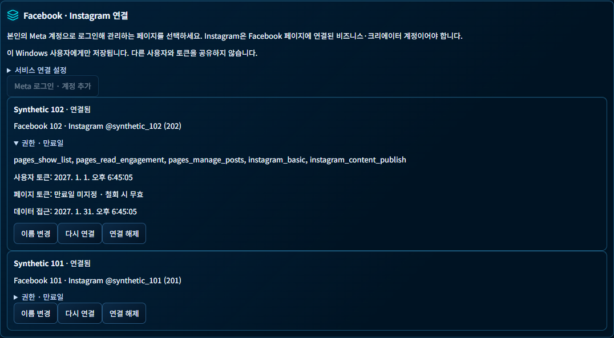
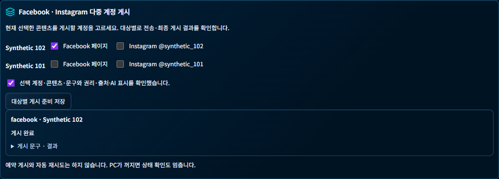

# Meta 다중 계정 개발 검증 — 2026-11-02

판정: **CONDITIONAL — 새 기능의 모의 검증 통과, 실제 연결·게시 및 운영 반영 미실행.**

기준 브랜치는 `codex/newsflow-character-shorts-automation-20261030`, 기준 SHA는 `7820915626be95818e8dfdb18ac71fca6568ec73`이다. 작업 중 원격 최신 HEAD가 이 SHA와 동일한 것을 fetch로 확인했다. 기존 미커밋 변경을 보존하고 이 기능의 파일만 커밋한다. 최종 구현 커밋은 이 보고서를 포함하는 Git 커밋으로 식별한다.

## 로컬 검사

| 검사 | 환경 | PASS | FAIL | SKIP |
|---|---|---:|---:|---:|
| 최종 Meta 모의 계정·게시·권한·만료·중복·미디어·BAT 경계 | Windows Python 3.14 | 47 | 0 | 0 |
| 동일 최종 Meta 검사 | Windows Python 3.12 | 47 | 0 | 0 |
| 독립 headless Chrome의 계정 화면·선택 대상 게시 | Windows Python 3.14 | 2 | 0 | 0 |
| Meta 초기 집중 집합 + 브라우저 + DB + 기존 인증 중계/클라이언트 | Windows Python 3.14 | 120 | 0 | 0 |
| Meta 초기 집중 집합 + 기존 인증 중계/클라이언트 + studio_v3 | Windows Python 3.12 | 172 | 0 | 0 |
| 새 DB 버전에 영향받은 기존 마이그레이션·보존·복원 검사 | Windows Python 3.14 | 21 | 0 | 0 |
| studio_v3 직접 실행 | Windows Python 3.14 | 58 | 0 | 0 |
| frontend 계약 | 기존 Node | 47 | 0 | 0 |
| React TypeScript·Vite 빌드 | 기존 Node | 성공 | 0 | — |
| 신규 Meta 코드 및 BAT 어댑터 Ruff | Python 3.14 | 성공 | 0 | — |

120/172 집합에는 후속 로그인 오류 안내 테스트 2개가 들어가기 전의 Meta 45개가 포함된다. 최종 Meta 47개는 두 Python 환경에서 별도 실행했다. 위 수치는 서로 겹치므로 합산한 신규 PASS 수로 사용하지 않는다. headless Chrome은 별도 임시 DB와 모의 미디어를 쓰며 사용자 Chrome·운영 세션을 조작하지 않았다.

FastAPI testclient의 기존 httpx 사용 중단 예정 경고와 빌드의 기존 폰트 경로/모듈 지시문/큰 청크 경고는 남아 있다. 실제 사용 가능한 폰트·계정·API·운영 성능을 검증한 결과로 확대하지 않는다.

## 실행 명령

기존 설치된 Python 3.14/3.12 및 Node를 사용했다. 새 런타임 설치나 운영 실행기 재구성은 하지 않았다. 개발 디렉터리에서 `PYTHONPATH=src;tools`를 설정했다.

```powershell
python -m pytest -q -rs tests/test_meta_accounts.py
python -m pytest -q -rs tests/test_meta_browser.py
python -m pytest -q -rs tests/test_meta_accounts.py tests/test_meta_browser.py tests/test_database.py tests/test_instagram_relay.py tests/test_instagram_relay_client.py
python -m pytest -q -rs tools/studio_v3/tests
node --test tests/*.test.mjs
# frontend 디렉터리
node node_modules/typescript/bin/tsc -b
node node_modules/vite/bin/vite.js build
```

초기 실행에서 기존 개발 환경의 `tools` 경로가 빠진 수집 오류는 `PYTHONPATH` 설정으로 바로잡았다. `tools/studio_v3/tests`와 일부 기존 브라우저 테스트를 한 프로세스에서 함께 수집하면 `conftest` 이름이 충돌하므로 두 검사는 각각 실행했다. frontend 계약 명령은 frontend 하위 폴더가 아닌 `newsflow-ai`에서 실행해야 하며 최종 47개가 실제 실행됐음을 확인했다. 0개 실행을 성공 증거로 쓰지 않았다.

## 전체 검사와 잔여 실패

저장소 규칙에 따라 `python -m pytest -q -rs`를 실행했다. 작업 중간 상태의 전체 실행은 **6888 PASS / 129 FAIL / 24 ERROR / 50 SKIP**, 38분 16초였다. 전체 통과로 표시하지 않는다.

확인된 직접 영향은 추가 DB migration 0019와 기존 테스트의 head 0018 기대값 충돌이다. 기대 버전만 0019로 갱신하고, 구형 복사 도구가 새 스키마를 무심코 복사하지 않도록 0019 거절 사례도 추가했다. 기존 데이터·테이블 보존과 복원 assertion은 그대로 유지했으며 관련 검사 **21개가 최종 통과**했다. 과거 migration 파일은 수정하지 않았다.

전체 실행에는 FFmpeg 실행 경로 누락에 따른 렌더/fixture 실패, `NEWSFLOW_BASELINE_GUI_SOURCE`가 필요한 기존 화면 검사, 기존 UI 대기 시간 초과 등의 실패도 있었다. 변경한 Meta 코드 밖의 모든 실패가 기존부터 있었다고 단정하지 않으며, 이번 범위에서 그 실패들을 전부 고치거나 전체 재실행으로 해소했다고 주장하지 않는다. 마이그레이션 재검사에는 기존 격리 설치본의 FFmpeg/FFprobe 절대 경로를 검사 프로세스에만 지정했다. 새 Meta의 최종 검사와 브라우저 검사는 이 전체 실행 이후 별도로 통과했다.

따라서 저장소 전체 회귀는 미해결 상태이며 새 기능 집중 검증과 구분한다. CI를 새로 실행해 성공했다고 보고하지 않는다.

## 확인한 동작

- 두 모의 사용자의 여러 페이지/Instagram 연결이 섞이지 않는다. 다른 소유자의 연결 조회·수정·토큰 접근·게시 기록·전송을 거절한다.
- 선택한 페이지의 토큰/ID로만 전송하고 다른 대상은 별도 상태로 남는다. 모의 이미지·동영상에서 Facebook/Instagram 흐름을 각각 확인했다.
- Facebook 객체 존재만으로 성공 처리하지 않는다. Instagram은 처리 완료 전 게시하지 않고, 최종 결과 조회 전에는 성공으로 확정하지 않는다.
- 미동의, 변경된 미디어, 재연결된 계정 revision, 권한 부족, 만료·무효 연결은 전송을 거절한다.
- 사용자 토큰 만료, 페이지 토큰 만료, 데이터 접근 만료를 분리한다. 페이지 만료일 미지정을 무조건 영구 유효로 처리하지 않는다.
- 실패·결과 불명·중단된 POST는 자동 재시도하지 않는다. 지연된 상태 조회가 완료 상태를 이전 단계로 되돌리지 못한다.
- 토큰을 화면 JSON·브라우저 URL·오류 문구에 넣지 않는다. 서버가 돌려주는 오류 원문 대신 제한된 오류 코드를 사용한다.
- HTTPS 미디어 업로드는 사용자별 키·해시를 검사하고, 만료/철회 URL은 다운로드를 거절한다. Range 요청을 지원한다.
- PNG를 게시할 때는 별도 JPEG 사본만 만들며 원본은 변경하지 않는다.
- 로컬 상태 조회만으로 Meta 로그인·토큰 사용·미디어 업로드·게시가 실행되지 않는다.
- 기존 CSRF 보호 및 두 action 카탈로그의 경로 등록을 검사했다. BAT의 외부 Meta 경로는 명시적으로 설정하지 않으면 차단된다.

## 화면 증거

두 화면 모두 합성 계정과 합성 미디어다. ‘게시 완료’는 Fake 공급사의 응답을 검증한 테스트 상태이며 실제 SNS 게시 성공이 아니다.





## 원본 보존 및 미완료

- 운영 `C:\NewsFlowAI`, `D:\NewsFlowAI_Data`, 기존 기사·프로젝트·키·미디어·백업을 읽거나 변경하는 작업을 하지 않았다. 운영 Stop/Start, 18768 포트 사용, 계정 로그인, 유료 API 및 SNS 요청도 하지 않았다.
- 기존 migration 0001~0018, 기존 연결과 게시 기록, 무서명 업데이트 차단을 유지했다. 새 0019 migration은 임시 DB에서만 확인했다.
- 실제 NewFlow / specialist1979 및 별도 두 번째 Meta 계정의 연결, 실제 Windows 사용자 2개 격리, 실제 DPAPI 암호문 저장·복호화, v26.0의 실서비스 응답, 실게시 결과는 **NOT VERIFIED**다.
- 인증 서버/미디어 서버의 공인 HTTPS 주소와 서버 운영 설정, 서버 측 앱 시크릿·사용자별 업로드 키 등록이 필요하다. PC 패키지에 공용 앱 시크릿을 넣지 않는다.
- Meta 앱 심사·고급 액세스·비즈니스 인증·공개 정책 페이지 요건, 데이터 접근 만료의 최신 권한별 범위는 확정되지 않았다. 직접 공식 문서 조회가 HTTP 429로 제한된 사실을 [구현·운영 안내](META_MULTI_ACCOUNT.md)에 기록했다.
- 이 단계에서는 운영 배포, 실제 게시, 계정 연결 테스트를 승인받은 것으로 간주하지 않았다. 실제 테스트는 사용자 지정 계정과 콘텐츠로 별도 승인 후 진행한다.

정제한 실행 결과와 로그 해시는 [validation-summary.json](validation-summary.json)에 보존한다. 원본 로그·임시 DB·암호문·개인 자료는 커밋하지 않는다.
