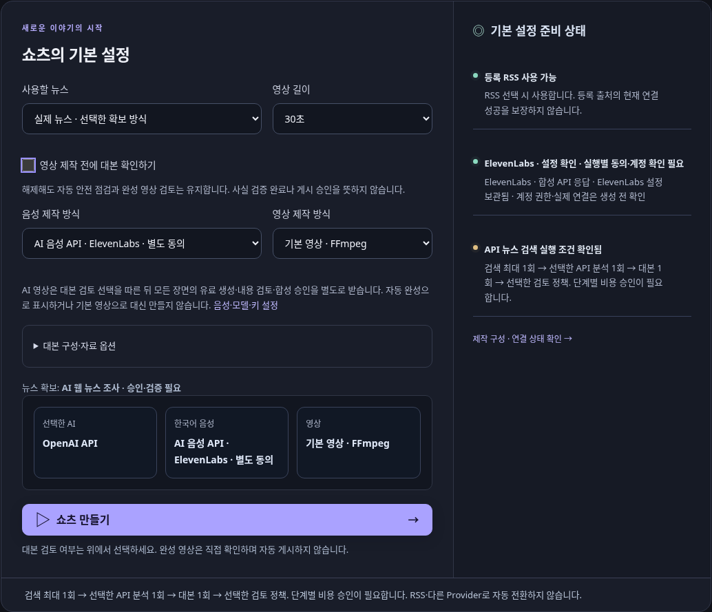
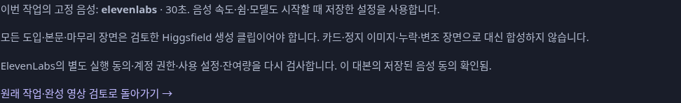
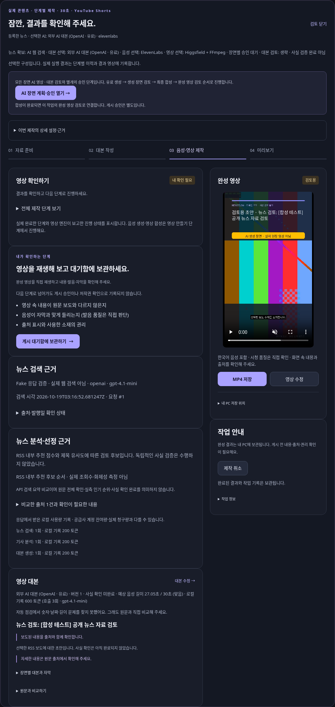

# 기본 영상·모든 장면 AI 영상 연결 검증

이 보고서는 이번 통합 요구사항의 로컬 구현 결과다. 과거 `production_choices_report.md`의 당시 지원 제한과 검증 기록은 수정하지 않는다. 실제 공급사 성공이나 전체 회귀 PASS를 의미하지 않는다.

보고: 2026-10-19T12:24:16.653141+09:00 (KST)

## 기준과 보존

- 기준 코드: `3c5230942466a87e5bc191961538e9bbccddc90b`.
- 영상 통합 검증 코드: `63431bf261eebefe1ea63e90c4e8d1eed2f77369`.
- 추가 설정 단순화 검증: `6f3fab4f66df1c30320f2e99e9e9c278918381de` 및 아래 최종 UI 보완 검증 SHA를 구분한다.
- 로컬 브랜치: `codex/newsflow-ux-video-app`. 연결 구현 위에 설정 단순화 커밋을 추가했으며, 마지막 커밋은 보고서·증거만 보존한다.
- [기존 PR #35](https://github.com/jsbae1979-prog/JSBAE/pull/35)는 조회 시 Draft이고 원격 HEAD는 기준 코드다. **이번 작업은 push·PR 본문/상태 수정·새 PR 생성 없이 로컬에만 보존했다.**
- main과 다른 브랜치/PR, 사용자 운영 DB·키·설정·기존 MP4를 변경하지 않았다. 운영 앱을 재시작하지 않았다. 기존 migration/DB 모델/의존성도 변경하지 않았다.

## 구현과 실제 절차

새 작업의 기존 `production_options` JSON을 버전 2로 저장한다. 버전 1과 옵션이 없는 과거 작업·혼합 장면 계획에는 새 정책을 소급 적용하지 않는다.

**기본 영상:** 기존 뉴스 확보 → 같은 선택 API의 분석·대본 → 자동 검사 → 선택에 따른 대본 검토 대기 → 고정된 로컬 음성 또는 별도 동의한 ElevenLabs → 기존 FFmpeg → 원래 작업의 완성 영상 검토 → 로컬 게시 초안. Higgsfield를 호출하지 않는다.

**AI 영상:** 위와 같은 뉴스·API·자동 검사·선택적 대본 검토 → 원래 작업에 연결된 모든 장면 AI 계획 → 사용자 모델·프롬프트·생성 조건 확인 → 별도 유료 생성 승인 → 모든 장면 생성·수신·무결성 확인 → 각 장면의 뉴스 관련성 검토 → 별도 합성 승인 → 고정된 음성과 기존 FFmpeg → 원래 작업의 완성 영상 검토 → 로컬 게시 초안.

도입·본문·마무리를 포함한 대본의 모든 장면이 생성 클립이어야 한다. 새 모드에서 카드·로컬 정지 이미지·누락·다른 대본/타이밍·미검토·변조 클립을 거부한다. 자막·제목·출처·AI 표시는 기존 FFmpeg가 담당한다. 기존 혼합 장면 모드는 그대로 남는다.

대본 확인은 기본 체크다. 해제하면 사람의 대본 검토 대기만 생략한다. 구조·출처·뉴스 활용 수준·금지 표현·복제·비밀정보·분량 등 기존 검사를 재사용하고, 경고도 중단 사유로 처리한다. 자동 검사 통과를 사실 확인이나 게시 승인으로 기록하지 않는다. 생성 승인·장면 검토·합성 승인·완성 영상 검토·게시 승인은 각각 유지된다.

### ElevenLabs + Higgsfield

새 버전 2 작업에서 안전한 연결을 갖춘 경우에만 기존 조합 차단을 해소했다. 단순히 차단문을 삭제하지 않았다. 서버의 원래 작업과 계획 참조에서 음성·동의·설정을 가져와 기존 `provider_for` → ElevenLabs Adapter → 공통 FFmpeg로 전달한다. URL/숨김 폼의 선택값은 유료 호출 동의가 아니다. 과거 버전 1의 조합 차단은 보존한다.

작업 시작 시 정확한 음성 ID·모델, 속도·쉼, 자막 스타일, 제작 길이·검토·영상 선택을 고정한다. 뉴스/분석/대본 API·모델은 기존 작업 기록을 유지한다. AI 장면의 명시적 생성 승인 범위와 revision별 모델·프롬프트·초·해상도·표시 금액도 기존 JSON에 추가 보존한다. 원래 작업 → AI 계획 → 렌더 결과 → 완성 영상 검토 → 로컬 초안을 연결했다.

전역 기본 설정 변경/재시작으로 작업 선택을 바꾸지 않는다. 현재 사용 중지는 실행 시 계속 확인한다. 음성 계정 키의 비밀값 대신 지문만 고정하고, 키가 바뀌면 새 계정으로 자동 전송하지 않는다. 대본 편집 뒤에는 자동 검사와 해당 대본 범위의 별도 음성 동의를 다시 요구한다. 동의 저장 자체는 새 요청을 실행하지 않는다.

실패·결과 불명 요청의 자동 재전송, 공급사/기본 영상/무음으로의 자동 대체를 추가하지 않았다. 기존 ElevenLabs 요청 장부·캐시와 Higgsfield 승인·사용량·중복 방지·결과 재조회 경계를 재사용한다. 실패한 음성을 다시 합성 승인해도 결과 불명 요청은 재전송하지 않는 테스트를 포함한다. 원래 작업 취소 후 미제출 장면은 새로 제출하지 않는다. 생성된 클립과 사용 이력은 보존한다.

로컬 음성은 저장된 SAPI/Supertonic 선택을 유지한다. 설치/사용 불가 시 중단하고 임의의 다른 로컬 음성을 고르지 않는다. 저장된 값이 무음이면 검토용으로 표시하며 내레이션 성공으로 보고하지 않는다.

## 변경 파일과 이유

| 파일 (`newsflow-ai/` 기준, workflow 제외) | 변경 이유 |
|---|---|
| `src/newsflow/autopilot/production_options.py` | 버전 2의 작업별 음성·스타일·계정 지문 검증/고정 |
| `src/newsflow/autopilot/contracts.py` | AI 계획 참조와 승인 대기 전달 |
| `src/newsflow/autopilot/backend.py` | 기존 자동 검사, 계획 생성/채택, 고정 음성·설정 전달 |
| `src/newsflow/autopilot/service.py` | 선택적 대본 대기, 단계별 승인 상태, 취소/복구/완성 결과 연결, 음성 동의 갱신 |
| `src/newsflow/gui/autopilot_routes.py` | 기존 제작 폼에서 선택값을 고정하고 별도 동의 전달 |
| `src/newsflow/gui/production_context.py` | 기존 화면 이동에서 버전 2 선택 보존 |
| `src/newsflow/gui/video_ai_routes.py` | 서버 계획 정책 표시와 음성 재동의 연결 |
| `src/newsflow/gui/templates/easy_home.html` | 독립 선택과 모든 장면 AI 모드 안내 |
| `src/newsflow/gui/templates/autopilot_start_guide.html` | 분석/대본과 음성의 별도 동의·선택 안내 |
| `src/newsflow/gui/templates/autopilot_job_detail.html` | 대본/장면/합성 대기를 구분하고 원래 작업에 결과 표시 |
| `src/newsflow/gui/templates/video_ai_plan.html` | 새 모드의 생성 장면 전용 선택, 고정 음성·동의·원래 작업 연결 |
| `src/newsflow/main.py` | 기존 coordinator 간 계획/완성 결과 연결 |
| `src/newsflow/video/production_policy.py` | 서버 소유 JSON 정책·대본 검사·음성 동의 범위 공통화 |
| `src/newsflow/video/ai/service.py` | 모든 장면 계획/검사, 승인 이력, 결과 연결. 기존 생성 Adapter 재사용 |
| `src/newsflow/video/service.py` | 고정 음성/설정/동의를 기존 합성 엔진에 전달 |
| `src/newsflow/video/voice_engines.py` | 현재 사용 중지/계정 키 변경 시 추가 요청 차단 |
| `tests/test_all_scene_production.py` | 두 API 각각 8조합, 실제 로컬 FFmpeg 합성·최종 검토/초안 검증 |
| `tests/test_all_scene_safety.py` | 승인·변조·취소·재시작·키 교체·결과 불명 회귀 |
| `tests/test_all_scene_browser.py` | 실제 Chromium에서 모든 장면+API 음성 승인→원래 작업 MP4 재생 |
| `tests/test_cloud_workspace_flow.py` | 새 버전의 자동 검사를 통과하는 정상 길이의 합성 대본 주입. 제품 검사 완화 없음 |
| `tests/test_production_options_browser.py` | 합성 키 지문과 기존 Adapter 인수 전달 반영. 기존 assertions 유지 |
| `.github/workflows/newsflow-cloud-connect-windows.yml` | 기존 Windows 3.12/3.14 변경 범위에 새 테스트 추가. 로컬 수정만, 실행 안 함 |

새 검색 체계·제작 엔진·TTS/영상 Provider·대시보드·의존성은 추가하지 않았다. 기존 IntelligenceService/뉴스/FFmpeg/TTS/게시 서비스를 재사용했다. 실제 운영 자료에 대한 일괄 갱신이나 migration은 없다.

## 최종 검증 결과

영상 통합 코드 `63431bf`의 변경 범위: **332 passed / 1 skipped / 0 failed / 0 errors / 1 warning**. 새 매트릭스 16건, 안전성 32건, Chromium 2건을 포함한다. 유일한 skip은 기존 native Windows DPAPI 플랫폼 조건이다. Ruff·pip check·diff check PASS. warning은 기존 Starlette/httpx TestClient deprecation이다.

이후 추가 지시에 따른 설정 UI만 수정했으므로 이 수치를 최종 UI 커밋 전체 테스트 결과로 대체하지 않는다. 추가 UI 검증은 아래에서 별도 SHA·명령·수치로 기록한다. 기존 제작 엔진을 바꾸지 않은 UI 수정 때문에 8개 조합의 16개 긴 렌더를 반복하지 않았다.

### 8개 조합 판정

각 행은 OpenAI/Claude API Fake 두 경로로 실행했다(16건). 로컬은 `supertonic:F1`을 유지하고 합성 TTS로 주입했다. 모든 결과에서 실제 로컬 FFmpeg/ffprobe를 사용했다. ACCEPTED는 **Fake/Cloud 연결 범위**의 판정이다. 각 조합의 실제 공급사·Windows 운영 판정은 CONDITIONAL이다.

| 대본 검토 | 음성 | 영상 | Cloud/Fake 판정 |
|---|---|---|---|
| 사용 | 로컬 | 기본 FFmpeg | ACCEPTED |
| 생략 | 로컬 | 기본 FFmpeg | ACCEPTED |
| 사용 | ElevenLabs | 기본 FFmpeg | ACCEPTED |
| 생략 | ElevenLabs | 기본 FFmpeg | ACCEPTED |
| 사용 | 로컬 | 모든 장면 Higgsfield + FFmpeg | ACCEPTED |
| 생략 | 로컬 | 모든 장면 Higgsfield + FFmpeg | ACCEPTED |
| 사용 | ElevenLabs | 모든 장면 Higgsfield + FFmpeg | ACCEPTED |
| 생략 | ElevenLabs | 모든 장면 Higgsfield + FFmpeg | ACCEPTED |

전 조합에서 뉴스 검색 1회 → 분석 1회 → 대본 1회 계약, 최종 영상 검토 대기, 명시적 검토 후 로컬 게시 초안을 확인했다. 게시 초안에는 계정/게시 승인을 부여하지 않았다. 기본 영상은 Higgsfield 0회, 로컬 음성은 ElevenLabs 0회다. AI 영상은 대본의 세 장면 전부 생성 클립이며, API 음성 조합은 합성 PCM과 클립을 하나의 MP4로 실제 합성했다.

16개 결과는 1080×1920 / H.264 / AAC / 약 30.021초다. 이번 매트릭스의 길이는 30초이며, 새 연결의 45/60초 전체 조합과 실제 품질을 검증했다고 주장하지 않는다. 기존 30/45/60초 제작 코드는 바꾸지 않았다. [매트릭스와 미디어 정보](evidence/all-scene-production/matrix.json).

### 기존 실패 비교

기존 Autopilot 상태/백엔드/경계와 AI 장면 서비스/GUI/합성 범위: **236 passed / 3 failed / 6 deselected / 0 errors / 1 warning**. 6개 deselected 항목은 위 최종 변경 범위 실행에 이미 포함된 테스트(한 항목의 매개변수 포함)이므로 중복 실행을 피한 것이다. 테스트 삭제나 새로운 skip은 없다.

동일한 Python 3.12 가상환경·의존성·환경값·명령으로 세 실패 ID를 기준 SHA의 격리된 소스와 최종 코드에서 각각 재실행했다. **동일 ID·실패 조건**이며 해당 테스트 파일은 바뀌지 않았다. 객체 메모리 주소만 정규화했다. 모두 기존 57 FAIL 목록에 포함된다.

- `test_autopilot_state.py::test_easy_synthetic_stages_are_durable_and_ordered`: 기존 `request` 기록을 제외한 단계 목록 기대값.
- `test_ai_video_gui.py::test_pages_render_default_off_and_keep_six_main_menus`: 이전 메뉴 6개 기대값(현재 5개).
- `test_ai_video_gui.py::test_key_form_stores_through_dpapi_store_and_never_renders_the_key`: Cloud에서 Windows를 모의할 때 `shutil._winapi` 부재.

[동일 환경 비교와 실패 메시지](evidence/all-scene-production/baseline-failure-comparison.json). **실행한 영향 범위에서 새 실패·오류 0건**이다. 전체 회귀를 재실행하지 않았으므로 전체 신규 실패 0건이라고 확대하지 않는다. 기존 전체 회귀 **57 FAIL** 기록은 유지하며 전체 PASS로 보고하지 않는다.

### 브라우저와 증거

실제 Chromium에서 OpenAI/Claude Fake 각각 제작 선택 → 별도 분석/음성 동의 → 모든 장면 모델 선택 → 별도 유료 생성 동의 → 장면 관련성 검토 → 합성 승인 → 원래 작업의 최종 검토 화면에서 MP4 재생을 확인했다. 브라우저 오류/외부 요청은 0건이다. 폼은 1366×768·1920×1080·390×844에서 가로 넘침을 점검했다. Windows 화면 배율 검증은 아니다.

아래는 운영 데이터가 아닌 **격리 Fake 시나리오 화면**이다. 첫 화면의 체크 해제는 테스트에서 명시적으로 선택한 상태이며 초기 기본값은 체크임을 별도로 검증했다.

[정확한 변경 범위 테스트 명령](evidence/all-scene-production/scoped-command.txt) · [환경·수치·증거 요약](evidence/all-scene-production/validation-summary.json).

## 추가 지시: 설정·설명 단순화

기존 통합 구현 위에서 작업했으며 새 설정 체계나 엔진을 만들지 않았다.

| 통합·삭제 | 실제 처리와 보존 |
|---|---|
| OpenAI 기존 상세 관리 | 중복 `ai_settings.html` 제거. `/ai-settings` GET/옛 책갈피는 통합 설정으로 이동. 기존 POST 저장·키·단가·점검 엔드포인트와 데이터는 유지 |
| 반복 요약·내부 도구 목록 | 상단 제작 요약/4개 상태 링크, 14개 내부 도구 대화상자, 관련 계산 helper·사용하지 않는 CSS 제거. 기능은 삭제하지 않고 제작/편집/게시의 기존 문맥과 주소로 유지 |
| 비용 편집 | API별 승인·월 한도 편집을 `api_budget.html` 하나씩만 렌더. 설정 첫 화면의 비용 영역에서 서비스별 한도/집계/관리로 접근. 서비스별 승인 checkbox와 서버 검사는 합치지 않음 |
| API Key | 이미 등록한 서비스의 입력은 접고 등록 상태/변경으로 표시. 미등록이면 등록 경로를 열어 두며 저장과 인증 확인/유료 검색 검증은 별도 행동 |
| 지원 범위 안내 | Claude Code에 붙었던 일괄 ‘권장’ 제거. CLI의 RSS 전용 범위를 표시하며 웹 검색 미지원 경고/차단은 유지 |
| Higgsfield 일반 조작 | 호스트·상태 간격·동시 수·제한시간의 일반 입력 제거. 기존 저장값을 hidden 값으로 그대로 전달하므로 저장 시 기본값으로 덮지 않음 |
| Higgsfield 모델 | 제작 시 확인된 모델의 이름으로 선택. 경로·단가·허용 길이 등록/수정은 필요한 고급 관리 하나에 유지. 미확인 모델·가격은 채우거나 확인 완료로 표시하지 않음 |
| 저장 위치 | 변경 기능처럼 보였던 별도 카드를 제거. 현재 경로 확인은 기존 진단에서 접근. 파일/위치/설정을 변경하지 않음 |
| 기술·중복 설명 | SDK·인증 헤더·요청 주소·상태값 나열·환경변수·DPAPI 설명, 설정의 중복 생성 기록 나열 제거. 기존 기술 보고서/소스·작업 기록 경로는 보존. 라이선스·비용·외부 전송·실계정 미검증은 짧게 유지하고 긴 이용 조건은 자세히 보기로 구분 |
| 게시·예약·운영 | 게시 계정 상태와 관리는 하나의 영역에 배치. 예약·자동 실행·진단의 기존 기능/동의는 유지. 운영체제 등록이나 실계정 연결은 실행하지 않음 |

설정 첫 화면은 뉴스·대본 AI / 기본 음성 / AI 영상 / 비용 관리 / 게시 계정이다. 일반 기본값과 작업별 선택의 역할을 유지하고 기존 작업의 JSON을 갱신하지 않는다. 대본 확인·로컬/ElevenLabs·기본/모든 장면 AI 선택과 모든 승인/사용량 경계를 유지한다.

추가 변경은 `gui/ai_settings_routes.py`, `gui/production_routes.py`, `gui/production_status.py`, 설정/연결/설치 안내 템플릿, `static/css/settings.css` 및 관련 UI 테스트다. 제거한 화면의 UI 기대값은 통합 화면 이동·중복 부재·기존 POST/CSRF/데이터 보존 검사로 변경했다. 승인·예산·비밀값 검사 assertion을 없애거나 제품 검사를 약화하지 않았다. 관련 없는 오래된 Studio/재시도 기대값은 수정하지 않는다.

**최종 검증 코드: `d7e74bb8f227d224a4dc494bbfb6a97ae3d80cc3`.**

- 설정/API/승인/제작 범위 중간 실행(`6f3fab4`): **547 passed / 4 failed / 0 skipped / 0 errors / 1 warning**. 이 중 새 브라우저 검사가 발견한 저장 버튼 겹침 1건은 공통 CSS 우선순위를 수정했다. 나머지 3개는 기존 57 목록의 오래된 가격/Studio·시작 화면·재시도 테스트다.
- 최종 UI 범위(`d7e74bb`): **95 passed / 2 failed / 0 skipped / 0 errors / 1 warning**. 설정 저장·재진입, 이미 등록한 키 입력 접기·비노출, 단일 비용 관리와 독립 승인, 변경/미등록 상태, 옛 링크 이동, 현재 저장값 보존, 제작 기본값 연결, 데스크톱/모바일과 브라우저 포커스 복귀를 포함한다. 실패 2개는 기준과 [최종 코드의 정확한 ID/실패 조건이 같은](evidence/all-scene-production/final-ui-failure-comparison.json) 기존 메뉴 개수/Cloud Windows 모의 GUI 실패다. [최종 UI 명령](evidence/all-scene-production/final-ui-command.txt). 새 브라우저 겹침 실패는 해소됐지만 이 실행 전체를 PASS로 표시하지 않는다.
- 최종 코드의 모든 AI 장면 + ElevenLabs + 대본 검토 생략 단일 합성 스모크: **1 passed / 0 failed / 1 warning**. 실제 FFmpeg/ffprobe, 최종 영상 검토 대기·게시 초안 경계까지 확인했다. 내려받을 합성 샘플을 남겼으며 실제 사람 음성이 아닌 합성 PCM이다.
- Ruff·pip check·diff check PASS. 이번 최종 UI 수정 이후 Autopilot/음성/AI 장면/렌더 핵심 6개 파일은 16조합 검사 코드 `63431bf`와 바이트가 동일하다. [해시·각 실행 SHA/수치](evidence/all-scene-production/validation-summary.json).

추가로 기존 시작/재시도 실패 2개는 같은 환경·정확한 ID/명령으로 기준 코드와 다시 비교해 실패 조건이 일치했다. [비교](evidence/all-scene-production/additional-legacy-comparison.json). 옛 가격 화면 테스트는 의도적으로 폐기한 UI 검사만 변경했으며 후반의 별도 Studio 모델 기대값은 수정하지 않았다. 후반 assertion이 기준에서도 맞지 않는 것은 [동일 환경 probe](evidence/all-scene-production/legacy-studio-probe.json)로 재현했다. **이 마지막 항목은 원래 테스트 전체의 동일 실패 비교가 아니므로 전체 동일성은 NOT VERIFIED**다. 해당 3개를 이번 작업에서 관련 없는 엔진 수정으로 없애지 않았다.

8개 조합의 16건 렌더는 UI 정리 전 `63431bf` 결과다. UI 정리 후 `6f3fab4`의 OpenAI/Claude 브라우저 통합 동선과 최종 코드의 위 1건 실제 합성으로 연결을 재확인했다. 서로 다른 SHA 결과를 합쳐 하나의 ‘최종 전체 회귀 PASS’로 표시하지 않는다. 기존 57 FAIL 기록과 테스트/승인/사용량 데이터는 보존한다.

변경 목록은 [전체 파일 JSON](evidence/all-scene-production/changed-files.json)을 참고한다. 로컬 코드 커밋은 `63431bf`, `ce330b1`, `6f3fab4`, `d863575`, `d7e74bb` 순서다. 기존 커밋을 재작성하지 않았다.

전후는 같은 Cloud 기본 상태(키/모델 미설정)의 격리 UI이며 운영 자료가 아니다. 단순화 전은 `63431bf`, 후는 아래 최종 UI 보완 코드다. 저장된 키를 접는 동작은 합성 키를 주입한 별도의 실제 브라우저 동선으로 검사했다.

| 화면 | 전 | 후 |
|---|---|---|
| 설정 | [전 화면](evidence/all-scene-production/settings-before.png) | [후 화면](evidence/all-scene-production/settings-after.png) |
| Higgsfield 설정 | [전 화면](evidence/all-scene-production/higgsfield-before.png) | [후 화면](evidence/all-scene-production/higgsfield-after.png) |

필수 고급 관리로 남긴 것은 모델/가격 확인, 서비스별 승인·한도·단가, 계정 연결 사전 설정, 예약/운영/진단이다. 안전한 실행이나 기존 사용자의 복구에 필요하므로 화면 정리를 이유로 삭제하지 않았다. 공급사 기술 근거는 기존 [Higgsfield 검증 보고서](phase5d_higgsfield_api_verification.md) 등에 보존한다.

## 미검증과 판정

- **NOT VERIFIED:** 이번 SHA의 Windows Python 3.12·3.14 Actions/BAT/native DPAPI. 로컬 워크플로는 준비했지만 사용자 지시가 원격 push와 PR 변경을 금지하므로 새 CI를 실행하지 않았다. Cloud Python 3.14도 설치되지 않았다. 과거 Actions `39187420264`/283 passed는 이전 SHA의 역사적 결과이며 이번 코드 결과로 대체하지 않는다.
- **NOT VERIFIED:** 실제 ElevenLabs 계정 권한·음질·한국어 발음·실제 사용량/청구액, Higgsfield 모델/가격/생성 품질, 사람이 청취한 음성·자막 동기화, 실제 OpenAI/Claude 콘텐츠 품질, 사용자 Windows 11 PC/화면 배율/기존 데이터 운영, 실제 OAuth·SNS 게시.
- 개발·테스트는 Fake 뉴스/API/키/음성/클립과 임시 DB·파일만 사용했다. 실제 OpenAI·Claude·ElevenLabs·Higgsfield 유료 호출 **0건**, 실제 OAuth/업로드/SNS 게시 **0건**. 합성 PCM은 실제 내레이션 품질 증거가 아니다. 추측 비용 예약이나 요청별 금액 한도를 새로 도입하지 않았다.
- **종합 CONDITIONAL:** 로컬/Fake 연결과 안전성은 검증 범위에서 판정한다. Windows 최종 코드 검증과 실제 공급사/사람의 품질 평가를 충족한 운영 완료 판정은 아니다. 후속 최소 작업은 별도 원격 반영 승인 뒤 기존 Windows 3.12/3.14 워크플로 실행, 이후 별도 실계정·유료 호출 범위 승인과 사용자 PC 검증이다.
- 요청 범위를 넘는 추가 개발·실호출·원격 반영·병합 없이 종료한다.
