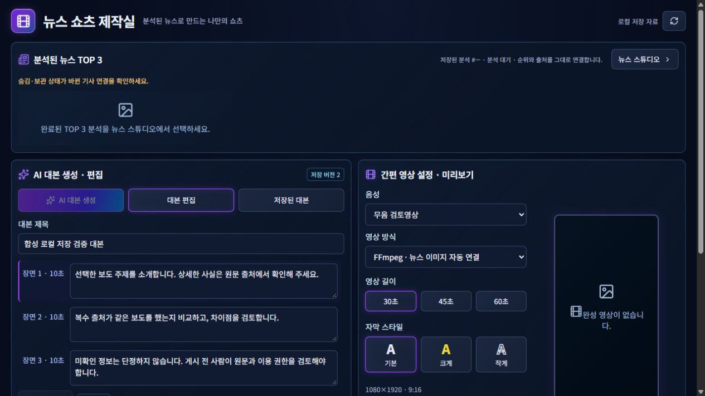

# 신규 BAT 실사용 전환 준비·합성 로컬 저장 집중 검증

**최종 판정: CONDITIONAL.** 합성 프로필의 로컬 쓰기·저장·복구·재실행과 기본 브라우저 자동 열기는 검증했다. 실제169건 프로필의 쓰기는 활성화하지 않았으며, `C:/NewsFlowAI`의 실제 시작 설정 변경도 적용하지 않았다.

- 브랜치 `codex/newsflow-bat-distribution-prep`
- 기준 HEAD `f435eace85f8da80c0eb633ecdd0d7857b2647c2`
- 새 연결부 구현 SHA **`c65eef44beadd2910aa7e95fd30def0447667c52`**. 이 보고서를 포함하는 최종 HEAD는 Git 이력 참조.
- 합성 실행 후보는 기존 `bat-startstop-validation-20261029/NewsFlowAI`를 재사용했다. 데이터는 형제 `SyntheticProfile`, 고정 loopback **18769**. 기존8765와 실제 신규 설치본18768은 사용/실행하지 않았다.
- 실제 신규 설치본은 `C:/NewsFlowAI`, 설치 연결부 SHA는 이전 **04d04aa** 상태 그대로다. 이번 개발 결과를 실제 설치본에 적용 완료했다고 주장하지 않는다.

## 1. 읽기 전용 위치와 모드 구분

| 모드 | 데이터/쓰기 | 실행 조건 |
|---|---|---|
| 기존 restored-private-validation | 실제169 복사본, HTTP 읽기만 | 외부 launch.json의 readOnly=true·decryptCredentials=false, 설치 ID·SID·설정 해시 확인 |
| synthetic-local-work (신규) | 합성 프로필의 명시된 로컬 저장만 허용 | syntheticOnly=true·고정 SyntheticProfile·무DPAPI·고정포트; 다른 경로 채택 금지 |
| 실제169 로컬 쓰기 | **미활성 / 별도 승인 대상** | 이번 합성 검증 결과만으로 자동 전환하지 않음 |

읽기 전용은 제품 제작 엔진이 아니라 BAT 연결부의 `RestoredRequests`에 있다. `windows_live.load_config/_profile`가 프로필 종류와 소유권을 확인한 후 다른 요청 경계를 선택한다. 전역 Guard·파일 경로 허용 목록·운영 서버·제품 API/DB 코드는 바꾸지 않았다.

새 `LocalWorkRequests`는 기존 React 모달이 호출하는 로컬 초안·설정·대본 편집 경로만 허용한다. 변경 요청은 그대로 기존 LocalAccess→Origin/CSRF→서비스 유효성/Revision/승인 처리를 거친다. `/ai/analyze`·`/ai/generate`는 provider=offline 단일 값만 허용하며 본문을 bounded 검사 후 원본 그대로 전달한다. 실제 공급사·OAuth·SNS·예약 실행·유료 이미지/영상 생성 경로는 계속 거절한다. 합성 RSS는 `FakeRSSAdapter`를 생성자에 주입하므로 외부 네트워크 수집이 아니다.

기존 restored-private-validation의 쓰기 차단은 그대로이며 새 모드에서만 로컬 쓰기가 가능하다. 실제169 프로필을 일반 모드로 위장하거나 키/암호문을 합성 프로필에 복사하지 않았다.

## 2. 구현 범위

- `tools/bat_distribution/local_work.py`: 로컬 저장 경계 + offline-only 분석/대본 + Fake RSS fixture.
- `windows_live.py`: 프로필별 요청 경계/adapter 구분, 기존 webbrowser.open 결과를 비민감 bool로 기록.
- `bundle_assembly.py`: controller에 기존 의존 모듈과 새 모듈을 포함할 목록 갱신. 실제 전체 패키징/ZIP 재생성 없음.
- `tests/test_local_work.py`: 변경 영향12건.
- React/CSS/제작 엔진·운영 Guard·DPAPI 알고리즘·DB migration 변경0.

합성 후보에 참조 의존 모듈 `restored_install.py`가 빠져 최초 실행이 ModuleNotFoundError/exit2로 끝났다. 기존 모듈1개만 추가한 뒤 정상 기동했다. 정책 허용 확대나 바이너리 변경은 하지 않았다. 성공3주기와 초기 준비 실패를 구분한다.

## 3. 쓰기·저장·재조회

최종 집중 검사 **44 PASS / 미해결 FAIL0 / ERROR0**:

| 신규 범위 | 결과 | 근거 |
|---|---|---|
| 요청 경계 영향 단위 | 12 PASS | junit-local-work.xml |
| 실제 로컬 저장/API 동선 | 27 PASS | WRITE_CHECKS.json |
| 재실행 React GUI | 5 PASS | GUI_CHECKS.json 및 합성 캡처 |

기존56 PASS·BAT2주기·패키징·FFmpeg 증거는 재사용했고 신규 결과로 합산하지 않았다. 전체 회귀·Guard/V3 감사·기존169 복원·디자인 검증은 반복하지 않았다.

확인한 실제 저장:

1. Fake RSS→기존 collection engine으로 합성 기사1건 저장.
2. 오프라인 분석·30초 대본 생성→대본 편집 저장→Revision2.
3. 이전 Revision으로 저장하면409, 기존 저장 내용 유지.
4. 이미지 모델/1:1/초안 품질 기본값 저장, 이미지 초안 및 참조 PNG 저장.
5. 캐릭터 참조 PNG·주제·모델·제작 한도 저장. 상태는 `needs_script`; 생성 완료로 표시하지 않음.
6. 설정 request_timeout 수정 후 원래 값으로 복원.
7. 누락 CSRF·외부 Origin403, 동의 필드를 붙인 실제 Claude 생성 요청도403.
8. 유료 이미지 생성403, API 비용 요청 기록0, DPAPI 파일0.
9. 재실행 후 저장 모델/비율/품질·캐릭터 모델·저장 대본 재조회.
10. React의 이미지 초안 모달에서 저장 버튼을 눌러 새 초안이 실제 이력에 반영됨. 최종 이미지 초안2개, 기존 생성 성공으로 위장하지 않음.

미디어 생성은 제품의 참조 PNG 정규화/보관 경로를 통해 확인했다. 프로그램이 만든256×256 합성 입력만 사용했다. 유료 AI 이미지·MP4·음성은 생성하지 않았으며 FFmpeg 기존 검증을 재사용했다.

[React 이미지 초안 저장 캡처](image-draft-saved.png). 캡처는 합성 데이터만 포함한다.

## 4. 실패 복구·정상 종료·재실행

소유 합성 앱을 Stop으로 정상 종료한 뒤 기존 `offline.snapshot/restore`를 사용했다. 설정값과 PNG 파일을 합성 실패 상태로 바꾼 다음 복원했다. 스냅샷7개 파일의 bytes/hash 일치, SQLite integrity=ok, 원래 설정·Revision2·비용 요청0을 확인했다. 실제169 프로필을 복원하거나 수정하지 않았다.

첫 복구 시 검사 도구가 자신의 SQLite 연결을 남겨 WinError32가 발생했다. 해당 검사 프로세스의 정상 종료로 핸들이 해제된 후 explicit closing으로 재검증했다. 강제 잠금 해제·강제 sidecar 삭제·Guard 완화는 없었고 앱의 Stop 실패가 아니었다. 실패/결과 불명 작업을 성공으로 위장하거나 유료 요청을 재전송하지 않았다.

후속 재실행과 GUI 저장 결과를 포함한 **성공3주기의 Start·Stop 최종 코드는 모두0**이다. 최초 누락 모듈 실행exit2와 별도 기록했다. 최종 합성 Python0,18769 listener0. 기존 운영 PID4개(3684·12700·15012·26288)는 유지했다.

## 5. BAT→브라우저 실행 동선

합성 launch 설정만 openBrowser=true로 바꿔 동일 Start BAT를 실행했다. Windows Shell이 정상 브라우저 열기를 수락했고 기존 Edge 창에 NewsFlow AI Studio 탭이 확인됐다. 일회용 bootstrap 발급 후72.9초(유효120초 내)의 재사용 요청은403이었다. 정상 브라우저가 이미 인증을 소비한 결과와 일치하며 인증 우회는 없었다. 토큰/fragment URL/쿠키는 출력·Git 저장하지 않았다.

**BAT 실행과 브라우저 자동 열기 PASS**이며 실제 Explorer 마우스 더블클릭 자체는 NOT VERIFIED다. Start BAT는 cmd를 통해 실행했다. Edge의 기존 다른 탭/브라우저 프로세스는 종료하지 않았다. 합성 앱은 Stop으로 종료했고 테스트 탭은 기존 창에 남아 있을 수 있다. 그 탭에는 실제169 데이터가 없다.

## 6. 실제169 프로필 보호와 시작 설정 후보

실제 신규 데이터 DB와 인증 암호문6개의 hash·size·mtime이 이번 작업 전후 같았다. 실제 프로필을 앱에 연결해 실행하지 않았으며 읽기 전용 플래그도 true 그대로다. 원본169/별도0 DB·원본 키/OAuth·미디어·백업A/B에 쓰지 않았다. 기존56 PASS의 원본/백업 보존 증거를 재사용한다.

`C:/NewsFlowAI` 실제 시작 설정에 openBrowser=true를 적용하려던 명령은 **자동 심사에서 실행 전에 거절**됐다. 실제169 프로필의 구성 변경도 별도 승인 대상이라는 이유였다. 따라서 C 설치 파일·실제 launch.json·layout.json은 변경하지 않았다.

대신 별도의 비공개 `local-write-results/prepared-start-config/`에 두 후보를 준비했다. 검토 가능한 변경은:

- launch.json: **openBrowser false→true**
- app/layout.json: 위 설정 bytes의 **validationConfigSha256** 갱신
- **readOnly=true, decryptCredentials=false 그대로**, 실제 쓰기 활성화 없음

이 후보는 아직 적용하지 않았다. 실제 설치본의 브라우저 자동 열기 적용도 별도 명시 승인이 필요하다. 실제169 쓰기 전환과 자동화/유료 API/SNS 활성화는 이번 승인을 확장 해석하지 않는다.

## 7. 운영 전환 준비 판정·정리 조건

합성 자료로 검증한 **로컬 저장 기능과 실패 복구는 기술적으로 준비됐다.** 그러나 현재 C 설치본은 여전히 기존 읽기 전용 빌드/설정이며 실제169 데이터의 일반 쓰기 모드 전환 완료 상태가 아니다.

실제169 전환은 승인 후 프로필별 경계를 명시적으로 적용하고, 이미 보존된 before-first-start 복원점 및 정상 종료/단독 쓰기 조건을 유지해야 한다. 기존 운영본과 같은 DB에 동시 쓰지 않으며 현재도 별도 경로다. 실제 공급사 키 복호화·유료 API·OAuth·SNS·예약 실행은 이번에0회이며 계속 별도 승인 대상이다.

기존 운영 프로그램 삭제/종료/교체는0회다. 실제 프로필 전환·저장/복구 인수, 정확한 제거 파일 목록/보존 관계 확인, 별도 삭제 승인 전까지 구형 run.bat·소스·가상환경은 KEEP한다. DB·미디어·암호문·백업은 제거 후보에서 제외한다. 일반 사용자 외부 배포·main·PR35 변경0. Update는 배포자 인증서/신뢰 앵커 미확보로 계속 차단되며 실제 업데이트는 하지 않았다.

V3 Service Running, 실제 V3 실행 거절은 관찰되지 않았다. 비활성화·예외 등록·관리자 실행·ACL 전역 변경은 없었다.

## 8. 명령 검토 및 미검증 구분

자동 심사 거절은 세 건이다. 첫 번째는 소스 작업 폴더에서 상대 BAT를 실행할 위험이 있는 혼합 명령으로, 실행0회 후 복사와 합성 BAT 절대 경로 실행을 분리해 해결했다. 실제 프로필 설정 변경은 최초 명령과 두 필드로 축소한 재검토 모두 거절되어 적용하지 않았다. 후보와 읽기 비교 증거만 보존했고 이후 추가 적용 시도는 하지 않았다. 제한 우회는 하지 않았다.

미검증: 실제169 쓰기/편집, 실제 설치본의 새 자동 브라우저 설정 적용 후 실행, 문자 그대로의 마우스 더블클릭, 실제 유료 생성/게시, OS DPI. 초기 모듈 누락·검사 도구 핸들 문제는 해결 이력을 남겼으며 최종44건 통과와 혼동하지 않는다. 기존 Starlette/httpx deprecation 경고1종은 남아 있다.

개인 DB·암호문·session.key·복구 스냅샷·실제 프로필 설정 후보는 로컬 비공개 위치에만 보존했다. Git에는 코드·합성 캡처·비민감 결과만 보존한다.

검토 가능한 두 필드의 변경안은 [START_SETTING_CHANGES.md](START_SETTING_CHANGES.md)에 별도로 정리했다.
