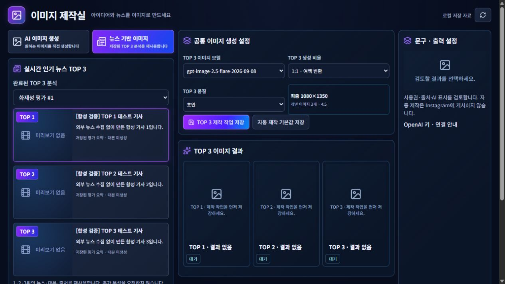

# BAT 실행 경로 결함 수정 및 신규 설치 집중 검증

**최종 판정: ACCEPTED — 격리된 신규 BAT 후보의 실행·종료 검증 범위.** 기존 운영본 교체·사용자 데이터 이전·일반 사용자 배포 인수가 아니다.

- 브랜치: `codex/newsflow-bat-distribution-prep`
- 작업 기준: `e531204ef515bbf5587d224e4ef45c0e43eec0ed`. 최종 등록 SHA는 이 보고서를 포함하는 Git 커밋 참조.
- 일시: 2026-10-29 KST. Windows 11, 일반 사용자 권한, 공식 내장 CPython 3.14.7 AMD64.
- 설치 후보: `C:\Codex\NewsFlowAI-IsolatedReview\bat-startstop-validation-20261029\NewsFlowAI`
- 합성 데이터: 설치 후보와 분리된 형제 폴더 `SyntheticProfile`; 테스트 포트 `127.0.0.1:18767` 고정.
- GUI 도구: Codex in-app Chromium 브라우저. 이번 화면 캡처 약1265×712. 실제 Chrome 전체 앱 또는 OS DPI 검증으로 확대하지 않는다.

## 1. 직접 원인과 두 파일의 정확한 정보

기존 검사는 `lifecycle.inspect_layout` → `zip_update.payload_name`을 통해 배포 프로그램 파일 경로만 받는다. 검증 전용 자료를 제품 inventory에 같이 넣어 생긴 구성 결함이었다. 두 파일 모두 기존 inventory에 등록돼 있었고 실제 파일의 bytes/SHA-256과 일치했다. 해시 불일치나 V3 탐지가 원인이 아니었다.

| 거절된 프로그램 상대 경로 | 크기 | SHA-256 | 용도 |
|---|---:|---|---|
| `app/validation-launch.json` | 190 | `b24e7446b8679b59b8b037f7524a3bdfd41b0824b6766adeb7be86c7560ce30c` | 합성 프로필·설치 ID·테스트 포트 실행 설정 |
| `README-VALIDATION.txt` | 196 | `463267914333f07f6275dcda32159f363ad4fc1d07f537bc2a63cbdcd9d27e04` | 비공개 검증 안내 |

둘 다 제품 사용자 설정이 아니므로 배포용 허용 목록에 새로 추가하지 않았다. 검증 실행 설정과 검증 안내를 프로그램 폴더 밖의 테스트 작업 폴더에 보존했다. 원래 바이트는 `e531204-rejected-assets/`에도 별도 보존했다. 불허 파일을 허용 접두사 아래로 숨기거나 실행파일 이름·바이트를 바꾸지 않았다.

## 2. 최소 수정 및 배치

```text
bat-startstop-validation-20261029/
  validation-launch.json         # 외부 검증 메타데이터; ZIP payload가 아님
  README-VALIDATION.txt           # 검증 안내; ZIP payload가 아님
  e531204-rejected-assets/        # 이전 두 원본 바이트 보존
  NewsFlowAI/                    # 프로그램만, 기존 허용 경로 그대로
    Start_NewsFlowAI.bat
    Stop_NewsFlowAI.bat
    app/layout.json              # validationConfigSha256에 외부 설정 bytes 결속
    app/controller/bat_distribution/...
    app/runtime/...
    app/product/...
    app/frontend/dist/...
  SyntheticProfile/              # 새 합성 DB·설정; 실제 사용자 자료 없음
```

- `contract_entry.py`: Start/Stop의 검증 설정 존재 확인을 고정된 외부 작업 경로로 변경.
- `windows_live.py`: 외부 설정은 4096 bytes 이하, 비링크 절대 경로만 사용하고, `layout.validationConfigSha256`과 일치해야 읽는다. 기존 syntheticOnly·고정 프로필·설치 ID·포트 제한은 그대로다.
- `test_windows_live.py`: 새 외부 설정의 해시 결속·변조 거절·외부 실행 설정이 없는 일반 배포본의 비활성 유지 및 영향받은 기존 제약 검사.
- `zip_update.py` 경로 허용 정책, Guard, 제품 Python/React, BAT 명령, 업데이트 서명 정책은 변경하지 않았다. 변경 diff는 [PATH_FIX.diff](PATH_FIX.diff)에 보존했다.

수정 후보 inventory는2878개 프로그램 파일로 기존 경로 계약 검사와 파일별 무결성 사전 검사를 통과했다. 외부 설정의 기존 SHA-256은 그대로이며, 구성 파일이 없거나 해시가 다르면 실행되지 않는다. 배포자 인증과 혼동하지 않으며, 업데이트 신뢰 앵커는 여전히 없다.

## 3. 실제 BAT Start/Stop 결과

| 실행 주기 | 확인 목적 | Start BAT 최종 코드 | Stop BAT 코드 |
|---|---|---:|---:|
| 1 | 수정 경로 계약·create_app·신규 DB·로컬 인증·HTTP 준비 | 0 | 0 |
| 2 | 정확한 React 경로·자산·Fake TOP3·CSRF 설정 저장 | 0 | 0 |
| 3 | 재실행 설정 보존·실제 브라우저 렌더링·탭 이동 | 0 | 0 |

Start가 서버를 유지하는 동안은 실행 중으로 두고, 각각 별도의 Stop BAT가 동일 사용자·프로세스 생성 시각·실행 파일·설치 ID·private 세션을 확인한 후 정상 종료를 요청했다. 실제 프로세스 핸들에서 종료0을 확인했고, Start 콘솔과 Stop 양쪽의 native 종료 코드를 별도로 수집했다. Ctrl+C/강제 종료/taskkill은 사용하지 않았다. 실패·결과 불명 경로를 성공0으로 바꾸지 않았다.

V3 Service는 전후 모두 Running이었으며, 세 차례 앱 실행에서 V3 실행 거절이나 WinError5는 관찰되지 않았다. V3 비활성화·예외 등록·관리자 실행·ACL 전역 완화·차단된 EXE 사용은 없었다. 이 결과는 장래 모든 환경의 보안 제품 허용이나 오탐 판정을 의미하지 않는다.

## 4. 신규 집중 결과

| 구분 | 결과 | 근거 |
|---|---|---|
| 수정 영향 단위 검사 | **6 PASS / 0 FAIL / 0 ERROR** | `junit-path-fix.xml`; 기존15 PASS 전체 재실행 안 함 |
| HTTP·자산·저장 검사 | **17 PASS / 0 FAIL** | `HTTP_CYCLE2.json` |
| 실제 브라우저 확인 | **8 PASS / 0 FAIL** | `GUI_CHECKS.json` 및 캡처4개 |
| BAT 기동·종료 | **3주기 성공, 모든 최종 코드0** | `LIFECYCLE_FINAL.json` |
| 테스트 자원 정리 | PASS | listener0, 후보 Python0, private 세션/부트스트랩 파일 제거 |

최종 집중 항목 합계 **31 PASS / 0 FAIL / 0 ERROR**(단위6+HTTP17+GUI8). BAT3주기는 별도 실행 증거이며 중복 합산하지 않는다. 기존15 PASS와 기존 패키징·설치·FFmpeg 증거는 재사용했다. 전체 회귀·V3 진단·Guard/디자인 감사는 하지 않았다.

초기 HTTP 검사 도구가 미등록 단수 URL `/studio/image`를 사용해404로 한 번 중단됐다. 등록된 `/studio/images`, `/studio/characters`로 검사 URL을 정정했으며 제품 라우트 코드는 변경하지 않았다. 이 검사 도구 오류와 최종31건 통과 결과를 구분한다. 단위 검사에는 기존 Starlette/httpx deprecation 경고1종이 남아 있다.

### GUI·TOP3·설정 보존

- 정상 일회용 로컬 인증 성공204; 인증 전 GUI403. 인증·세션·CSRF 토큰을 로그/보고서/Git에 출력하지 않았다.
- React HTML/JS/CSS 및 뉴스 쇼츠·이미지·캐릭터 페이지200.
- 실제 렌더링된 홈→뉴스 쇼츠 이동에서 합성 TOP1·2·3, Fake 분석#1, 기사 제목·요약 연결 확인.
- 이미지의 `뉴스 기반 이미지` 탭 클릭과 `/studio/images?mode=news` 직접 연결 모두 TOP3 전용 탭을 선택했다. 저장된 분석 선택 후 순위별 기사3건을 표시했다.
- CSRF 보호 기본값 저장 API로 `1024x1024`, `low`를 저장했다. Stop 후 새 Start 세션에서 실제 UI의 `1:1 · 여백 변환`, `초안`으로 보존된 것을 확인했다.
- 캐릭터 제작실은 참조/스토리/완성 영상이 없는 상태와 견적 미확정 유료 실행 차단을 정확히 표시했다. 실제 Claude·Seedance·이미지·음성 생성은 실행하지 않았다.
- 합성 기사3건과 Fake 분석1건은 새 DB에만 넣었으며 실제169건과 무관하다. 예약0·게시 예약0, DPAPI 파일0을 확인했다. 외부 뉴스 수집·유료 API·OAuth·SNS 요청은 실행하지 않았다.



추가 캡처: [뉴스 쇼츠](news-shorts.png), [독립 이미지](standalone-image.png), [캐릭터](character-shorts.png).

## 5. 운영·기존 자료 보존

기존 운영 PID3684·12700·15012·26288 네 개가 전후 유지됐다. 운영8765 사용/HTTP접근/종료/재시작 명령은 없었다. 기존169 DB, 0건 운영 DB, 키·OAuth·DPAPI·미디어·백업A/B는 후보에 연결하거나 읽거나 쓰지 않았다. 원본 DB 재해시·수량 재감사는 불필요하므로 반복하지 않았다.

검증 후보 외의 기존 ZIP2개·EXE 후보·기존 프로그램·샘플12개는 변경하지 않았다. 새 외부 전달 ZIP을 만들지 않았고, 기존 ZIP dispatcher가 활성화됐다고 주장하지 않는다. 권리 미확인 샘플은 계속 제외되어 GUI에 샘플 미포함/읽기 실패 안내가 보인다. 기존 사용자 샘플이나 디자인은 바꾸지 않았다.

종료 후 테스트 포트18767 수신0·후보 Python0, private stop/bootstrap 세션 없음, 임시 HTTP cookie jar 제거. 합성 DB·저장 설정·비민감 증거는 별도 폴더에 보존했다. 재시작이 가능한 검증 후보이며 외부 사용자 전달본이 아니다.

## 6. 인수 범위 및 남은 조건

이번 요청의 경로 결함과 격리 신규 BAT Start/Stop 인수 차단은 해소됐다. **별도 경로의 합성 신규 후보는 정상 실행·GUI 접근·정상 종료·재실행 가능하다.**

기존169 데이터 연결/이전, 기존 운영본 교체/삭제, 실제 공급사 API·OAuth·SNS, 공개/외부 배포는 수행하지 않았으며 별도 승인 대상이다. 고정 SyntheticProfile을 사용하는 검증 전용 구성으로 실제 다중 사용자 배포 완료를 주장하지 않는다. 기존 ZIP 배포 활성화·서명된 오프라인 업데이트·샘플 권리/FFmpeg 대응 소스의 외부 전달 조건은 그대로 남아 있다. 실제 Windows OS DPI·신규 사용자 PC 검증은 이번 범위에서 NOT VERIFIED다.

완료 후 앱과 임시 브라우저 탭을 정상 정리했고 운영 전환 없이 종료했다.
