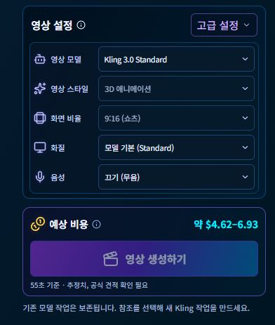

# 캐릭터 영상 설정 운영 반영 및 기본 샘플 제거

최종 판정: **CONDITIONAL** — 요청한 UI·API·카탈로그 반영, 기본 샘플 제거, Chrome GUI와 데이터 보존 확인은 완료했다. 실제 유료 생성·공급사 권한·공식 견적 및 모델별 native 화질은 이번에 검증하지 않았다.

- 브랜치: `codex/newsflow-bat-distribution-prep`
- UI·샘플 제거 코드: `de838fb89a21e2a5efaaad6cb39674398e351d28`
- 이미지 조회 최소 수정 및 운영 코드: `07e8a4b3d3b1f52fcdf3ddfeefc4b95f11bb8fa6`
- 운영 설치: `C:\NewsFlowAI`, 주소: `http://127.0.0.1:18768`, 최종 확인 PID: **14720**.
- 최종 보고서 커밋은 위 코드와 증거만 추가하며, 설치된 실행 코드 SHA는 `07e8a4b`다.

## 영상 설정 UI

첨부한 설정 패널을 기준으로 상단 고급 설정, 아이콘을 포함한 5개 행, 별도의 예상 비용·그라데이션 생성 버튼을 구현했다. 화면 구조 판정은 **MATCH**, 폰트·SVG·실제 모델 표시값의 미세 차이는 **MINOR**다. 단일 PNG 배경이나 장식 버튼으로 대체하지 않았다.

| 항목 | 실제 반영 |
|---|---|
| 영상 모델 | `Kling 3.0 Standard`, `Kling O3 Standard` 두 개만 선택 |
| 영상 스타일 | 기존 지시서의 `3D 애니메이션` 고정값 유지 |
| 화면 비율 | 기존 지시서의 `9:16 (쇼츠)` 고정값 유지 |
| 화질 | 모델 기본(Standard) 선택. 확인되지 않은 native 480p/720p/1080p/4k 전송은 비활성 |
| 음성 | 모델 소리 켜기/끄기. 가상의 음성 ID를 추가하지 않음 |
| 예상 비용 | 실제 설정에 따른 추정치와 미확정 안내. 시안의 120크레딧을 복제하지 않음 |
| 고급 설정 | 장면 길이·최종 저장 크기·상세 안내·승인 관련 조작 보존 |

모델별 미확인 공급사 옵션은 **FUNCTIONAL_CONSTRAINT**다. 최종 합성 크기와 공급사 native 생성 해상도를 혼동하지 않는다. UI에서 모델·설정을 선택하는 것은 유료 생성 실행과 분리된다.

[1366×768 개발 미리보기](development-1366.png)도 보존했다. 이 캡처는 합성 미리보기이며 운영 사용자 데이터 화면이나 실제 OS DPI 검증이 아니다.

## 기본 샘플 제거

- 제작실·라이브러리·기존 Workbench의 기본 샘플 갤러리·참조 캐릭터·복사/숨김 UI를 제거했다.
- 개발 소스의 번들 샘플 18개(이미지 9, 포스터 3, MP4 3, 메타데이터/문서 3)와 전용 UI 파일 3개를 삭제했다. 합계 **21개 / 7,311,131바이트**.
- 운영 설치에는 번들 샘플 자산이 이미 없었으므로 운영 자산 삭제는 **0개**다. 최신 React에서 관련 UI도 제거됐다.
- 사용자 프로젝트·이미지·영상·기존 복사본은 삭제하지 않았다. 기존 복사본은 보관한 참조 파일로 읽기만 가능하며, 완성 AI 프로젝트로 표시하지 않는다.
- 기존 Git 이력·첨부 ZIP·승인 디자인 PNG·과거 보고서는 보존했다. 실제 TTS 음성 미리듣기는 유지했다.
- 샘플 원본·새 복사·숨김 API는 비활성이다. 기존 사용자 복사본의 인증된 `copy-file` 읽기 호환성만 유지한다.

파일별 삭제 이름·크기·해시는 [SAMPLE_REMOVALS.json](SAMPLE_REMOVALS.json)에 기록했다.

## Python API 및 운영 반영

개발 완료된 캐릭터 API·모델 카탈로그·YAML 설정과 최신 React, 기본 샘플 제거를 운영본에 반영했다. 최초 반영은 **20개 파일**이며, 후속 오류 수정은 그중 읽기 모델 한 파일만 다시 반영했다. 실제 설치 파일의 해시는 [DEPLOYED_FILES.json](DEPLOYED_FILES.json)에 있다.

운영 요청 경계에는 정확한 GET 모델 카탈로그, 로컬 캐릭터 설정 POST, 기존 사용자 복사본 GET/HEAD만 추가했다. 기존 LocalAccess·Origin·CSRF를 그대로 통과하며, 스토리·견적·submit·render·SNS는 기존 외부 실행 차단을 유지한다. `windows_live.py`와 운영 Chrome 인증 경로는 덮어쓰지 않았다.

운영 GUI 확인에서 이미지 TOP 3 조회의 `KeyError: studio_selection`을 발견했다. 이미지 읽기 목록에 잘못 포함된 캐릭터 전용 필드 4개만 제거했다. 캐릭터 읽기 필드는 유지했다. 합성 TOP 3 회귀 테스트 **1 PASS** 후 사용자가 추가 정상 Stop·Start 1회를 승인하여 반영했고, 실제 이미지·TOP 3 화면이 정상 표시됨을 확인했다.

## 실행 이력

사용자가 직접 Start/Stop을 수행하면서 최초 기록 PID가 변경됐다. 정식 Stop 시도 당시 PID 31320은 Windows 오류87로 부재가 확인됐고 HTTP 연결도 없었다. 따라서 이 시도는 정상 종료 성공으로 기록하지 않았다.

동일 사용자·설치·실행파일, 포트 공백, 47개 테이블 불변을 확인한 뒤 기존 파일 잠금 안에서 프로필을 백업하고 실행 기록 2개만 비공개 보관했다. `FAILED_OR_UNKNOWN`은 기존 백업에 남겼으며 유료 작업이나 결과 불명 작업을 재요청하지 않았다. 이후 최초 Start 1회는 성공했다.

이미지 오류 보정에 대해서는 **별도 승인된 정상 Stop·Start 1회**를 수행했다. Stop 코드 **0**, 새 PID **14720**, Chrome 자동 열기·새 정상 인증·세 제작실 확인이 완료됐다. 전체 성공 Start는 2회, 정상 Stop 확인은 1회이며 처음 이미 종료된 세션에 대한 실패 시도와 구분한다.

Windows 네트워크 목록 명령의 포트 상관 조회는 일치 결과를 제공하지 않아 그 항목을 PASS로 계산하지 않았다. 동일 주소의 HTTP 403(미인증 접근 차단), 실제 Python PID 생존, 인증된 Chrome의 API 자료 로딩은 확인했다.

## 집중 검증과 데이터 보호

| 항목 | 결과 |
|---|---|
| 이번 변경 집중 테스트 | **128 PASS / 0 FAIL / 0 ERROR** |
| 이미지 TOP 3 읽기 회귀 | **1 PASS / 0 FAIL / 0 ERROR** |
| TypeScript / Vite 빌드 | PASS |
| 샘플 제거 단독 테스트 | 위 128개에 포함된 20개 PASS. 중복 합산하지 않음 |
| 과거 샘플 전체 앱 테스트 | RETIRED / SKIP. 신규 통과로 계산하지 않음 |
| Chrome 정상 인증·뉴스·이미지·캐릭터 | PASS |
| 저장된 TOP 3 분석 #42 / 뉴스 이미지 탭 | PASS |
| 라이브러리·캐릭터·뉴스·이미지 기본 샘플 UI 없음 | PASS |
| 가로 넘침 | 개발 1366×768 및 실제 Chrome 확인 범위에서 없음 |
| 47개 테이블 논리 내용 | 실행 전후 SHA·건수 동일 |
| 암호문·미디어 등 보호 파일 26개 | SHA-256·ACL 동일 |
| 원본 DB와 백업 A/B | 기존 SHA-256 동일 |
| 실제 유료 생성·SNS·OAuth·OS DPI | NOT VERIFIED / 실행하지 않음 |

핵심 건수는 기사 **169**, 처리 기록 **49**, 대본 **6**, 영상 프로젝트 **7**, 이미지 게시물 **3**이다. 과거 문서의 처리 기록 48과 달리 이번 작업 시작 시 이미 49였으며, 이를 이번 변경으로 추가된 레코드로 계산하지 않는다.

실행 구성은 `readOnly:false`, `decryptCredentials:false`, `automaticJobsEnabled:false`, `externalExecutionEnabled:false`, `openBrowser:true`, 무서명 업데이트 차단을 그대로 보존했다. API 키·토큰·쿠키·bootstrap URL·운영 DB·사용자 미디어는 GitHub에 올리지 않았다.

## 남은 조건

실제 공급사 권한·유료 생성·공식 견적·native 화질 지원은 별도 승인/검증 대상이다. 자동화 예약·SNS·외부 배포·무서명 업데이트·PR 병합을 수행하지 않았다. 현재 운영본은 정상 실행 상태로 두고 개발 미리보기 서버만 정리했다. 전체 회귀·Guard·V3·샘플 무결성 감사를 반복하지 않았다.

변경 파일 전체는 [CHANGED_FILES.txt](CHANGED_FILES.txt), 비민감 검증 요약은 [EVIDENCE.json](EVIDENCE.json)에 있다.
