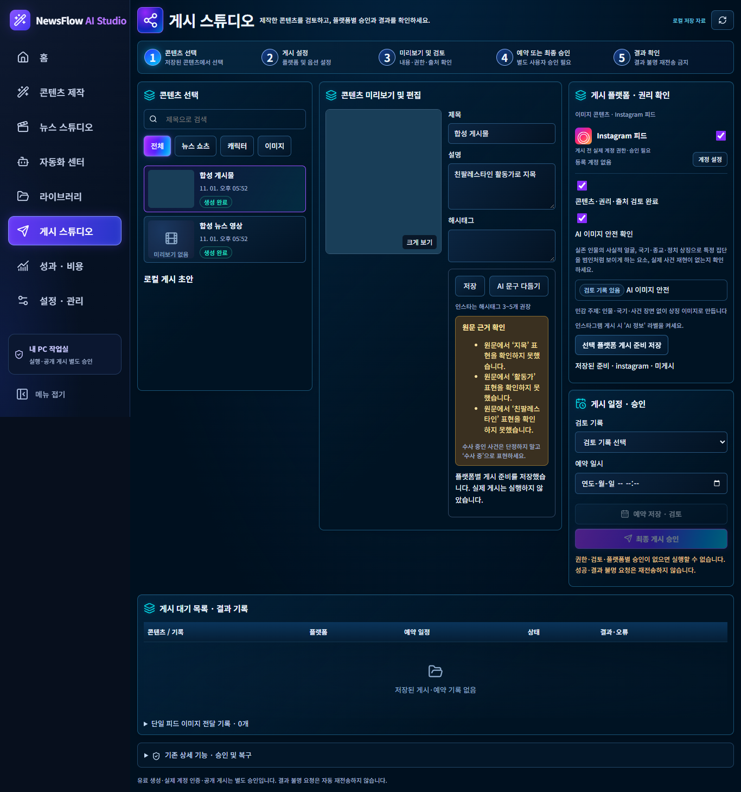
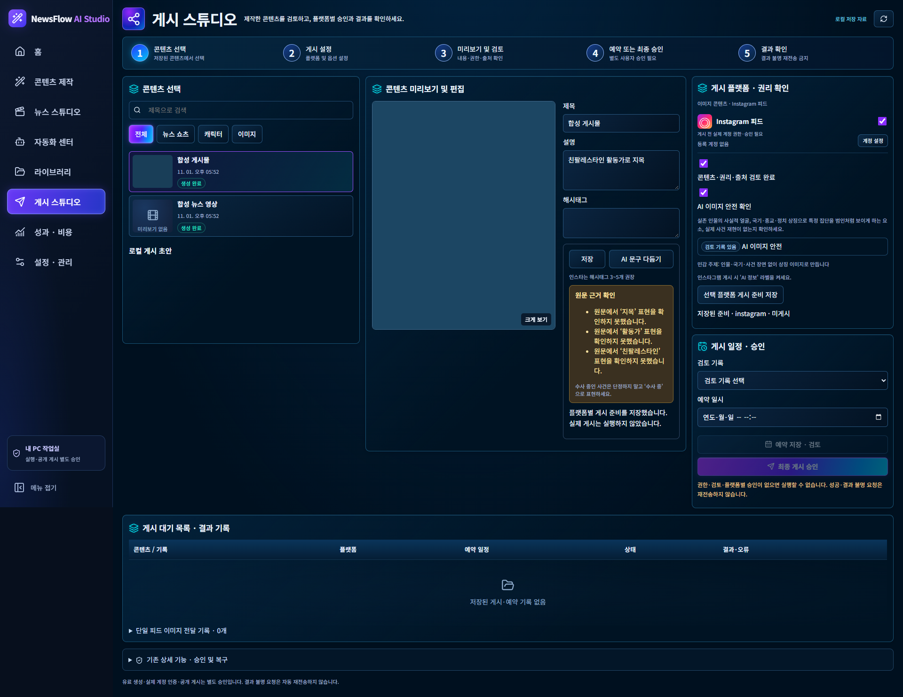

# Instagram 뉴스 피드 안전·품질 개선

- 작업일: 2026-11-01
- 브랜치: `codex/newsflow-insta-feed-safety-20261101`
- 기준: 최신화한 `codex/newsflow-character-shorts-automation-20261030`, `ef0f0f41cf66542202c7cddc8cd2b751b3398e96`
- 판정: 개발 및 Fake 검증 완료. 운영 반영과 실제 생성 이미지의 육안 검사는 수행하지 않음.

## 구현

1. `publishing/sensitive_topics.py`: 한국어·영어 민감 주제와 직함·이름을 규칙으로 분류. 이미지 생성의 네 경로에 인물·국기·무기·사건 재현 금지와 상징 이미지 지침 적용. 새 생성 기록에 분류와 적용 여부 저장.
2. `publishing/image_posts.py`, `preparation.py`, GUI routes/templates 및 React: AI 이미지 안전 확인 없이는 새 게시 검토본/게시 준비 저장을 차단. 체크 및 검토 상태를 게시 단계에 표시. 기존 게시물은 변경하지 않음.
3. `posting_copy.py`: AI 문구 검토 지침 보강. 편집 문구의 귀속 표현을 원문 기사 스냅샷과 비교해 노란 경고 표시. 경고는 저장을 차단하지 않음.
4. `categories.py`, `creation/top_three_feeds.py`, `feed_titles.py`: 뉴스 요약·주제·지역에 따른 해시태그 3~5개를 만들고 제목 교정의 해시태그 띠에도 전달. 기존 교정본을 다시 만들지 않음.
5. `image_generation.py`, `claude_cards.py`, `top_three_feeds.py`: 새 전체 이미지에는 제목과 최대 40자 한 줄만 배치하고 본문은 캡션에 유지. 기존 FullImagePlan의 본문 200자 제한은 유지.
6. `image_artwork.py`: AI 표기 크기를 약 1.5배 확대하고 대비 확보. 게시 단계에 Instagram의 AI 정보 라벨을 사용자가 켜도록 안내. 자동 설정한다고 표시하지 않음.

## 실제 코드와 지시서의 대응

- 게시 검토 편집은 `Publishing.tsx`가 아니라 기존 하위 컴포넌트 `management/PostingCopyReview.tsx`에서 처리하므로 해당 위치를 수정했다. 기존 이미지 크기·확대 팝업은 유지했다.
- 기존 `publishing/categories.py`는 YouTube 숫자 카테고리 매핑이다. 이를 변경하지 않고 별도의 뉴스 해시태그 함수를 추가했다.
- TOP 3 과거 요청의 두 프롬프트 경로는 그대로 유지하고 새 항목에만 `safety_version=1`을 저장한다. 예산 계산·전송 프롬프트·바인딩에 같은 버전을 적용한다. 과거 바인딩은 필드가 추가되지 않는다.
- 기존 POST 두 경로의 안전 확인 필드를 양쪽 actions 레지스트리에 함께 등록했다. 새 POST 경로는 없다.
- Claude 전체 이미지 새 지침은 v3 claim을 사용하며 완료된 v1/v2 결과와 과거 요청 기록은 그대로 재사용·보존한다.

## 변경 파일 묶음

- 분류·프롬프트·표시: `publishing/{sensitive_topics,categories,image_generation,claude_cards,feed_titles,image_artwork}.py`
- TOP 3·예산: `creation/{top_three_feeds,feed_costs,feed_budget}.py`
- 저장·게시: `publishing/{image_posts,posting_copy,preparation}.py`
- 서버 화면 연결: `gui/{creation_routes,image_post_routes}.py`, `gui/templates/image_posts.html`, `studio/actions.json`
- React: `TopThreeFeeds.tsx`, `core/TopThreeImageStudio.tsx`, `management/PostingCopyReview.tsx`, `contracts.ts`, `legacy-actions.json`
- 신규 검사: `tests/test_insta_feed_safety.py`, `tests/test_insta_feed_safety_browser.py`
- 기존 성공 경로의 명시적 안전 확인 반영: `test_codex_image_browser.py`, `test_codex_images.py`, `test_feed_korean_titles.py`, `test_full_image_pipeline.py`, `test_image_generation.py`, `test_program_review_fixes.py`

## 검증 결과

| 검사 | PASS | FAIL | ERROR |
|---|---:|---:|---:|
| 변경 전 image/feed/publish/posting 범위 | 747 | 13 | 0 |
| 변경 후 최초 동일 범위 | 766 | 14 | 0 |
| 최종 집중 재검증 | 119 | 0 | 0 |
| FFmpeg 환경 지정 후 기존 실패 12건 | 12 | 0 | 0 |
| 게시 플랫폼 기존 계약 최종 확인 | 1 | 0 | 0 |
| 별도 studio_v3 검사 | 58 | 0 | 0 |

- 신규 단위·브라우저 검사 22개가 최종 집중 검사에 포함된다.
- 범위 검사와 관련 재검증을 합쳐 중복을 제외한 782개 사례에서 PASS 증거를 확보했다. 한 번의 전체 실행이 모두 통과했다고 집계하지 않았다. 최종 미해결 실패는 0건이다.
- 최초 실패 중 12개는 FFmpeg 경로 미지정이었다. 기존 검증된 FFmpeg/FFprobe 경로를 명시하여 합성 데이터에서 해당 실패만 재검증했다.
- 변경 전 오래된 정적 번들을 사용하던 게시 UI 검사 1개는 새 번들로 통과했다. 변경 후 성공 경로 2개는 새 필수 안전 확인을 명시하도록 테스트를 보완했다. 기존 파일 무결성·플랫폼 제한 등 부정 검사의 목적은 유지했다.
- TypeScript 및 Vite 빌드 PASS. 기존 의존성 링크를 재사용하기 위해 `pnpm --config.verify-deps-before-run=false run build` 사용. 기본 명령은 pnpm의 의존성 자동 재설치 시 공유 node_modules 경로 보호 오류로 중단됐으며, 디렉터리 삭제나 재설치는 하지 않았다.
- 1366×768, 1920×1080 Fake 브라우저: 게시 단계 체크 위치, 미체크 저장 차단, 체크 후 진행, 비차단 문구 경고, 가로 넘침 없음 확인.
- 과거 TOP 3 프롬프트 두 경로의 SHA-256과 기존 예산 바인딩을 회귀 검사했다.
- 상세 집계: [validation-summary.json](validation-summary.json)

명령 범위: Windows Python 3.12, `PYTHONPATH=src;tests;tools`에서 `python -m pytest tests -k "image or feed or publish or posting" -q`; `tools/studio_v3/tests`는 conftest 충돌을 피하도록 별도 실행. 변경 범위 밖 전체 회귀는 반복하지 않았다.

## 화면 증거

합성 기사·이미지만 사용했으며 외부 요청을 차단했다.

## 보존 및 한계

- 유료 API 0회, SNS 호출 0회. 운영 배포·재시작 0회.
- 운영 DB·키·미디어·백업과 기존 생성 이미지·게시물·교정본은 접근/변경하지 않았다.
- 기존 별도 로컬 변경 3개와 기존 미추적 자료는 커밋에서 제외한다.
- 키워드 검사는 모든 민감 주제나 사실 오류를 발견하는 기능이 아니다. 생성 이미지의 픽셀 검사나 권리 적합성 자동 판정은 구현하지 않았다. 최종 이미지는 사람이 확인해야 한다.
- 실제 공급사의 이미지 결과, 실제 Instagram 라벨 동작, 운영 Chrome 적용 상태는 미검증이다.
