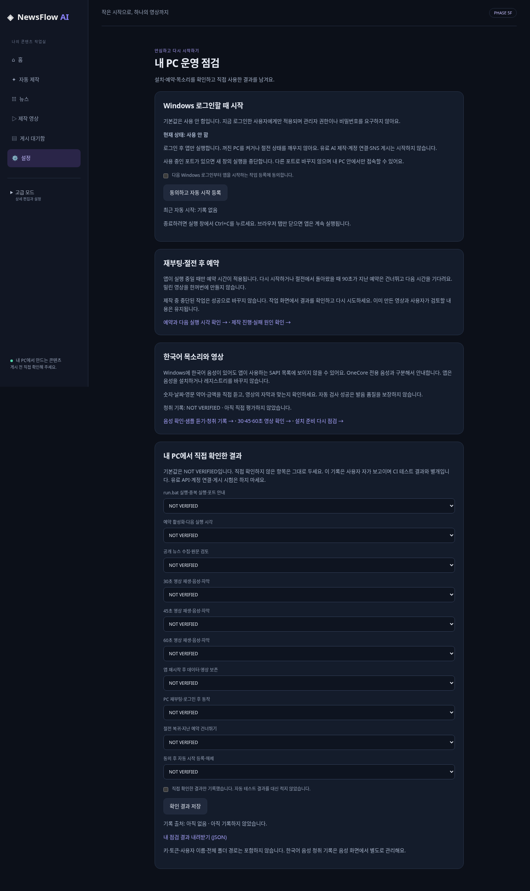

# Phase 5F — Windows 운영 준비 완료 보고

보고 시각: 2026-10-16 13:24 KST. 최종 판정은 사용자 검토를 기다립니다. 실제 사용자 Windows 11 PC·재부팅·절전·한국어 청취 품질은 NOT VERIFIED입니다.

## 1. 범위 및 기존 자산 보존

기준 `feat/newsflow-phase5e` / `a7730dd0e72f28bb09d0d1938e1b8be1dd665e04`에서 `feat/newsflow-phase5f`를 생성했습니다. [Draft PR #15](https://github.com/jsbae1979-prog/JSBAE/pull/15)의 base는 Phase 5E입니다. 기존 PR #1–#14 및 main은 수정·병합하지 않습니다. 커밋 재작성·force push 없음.

- 기존 `run.bat`, `tools/windows_launcher.py`, Easy Setup과 Python 설치 marker를 재사용합니다. 기존 BAT는 변경하지 않았습니다.
- 서버는 기존 `newsflow.main.run`, loopback socket, server/migration FileLock으로 실행합니다.
- 예약 엔진·KST 계산·90초 지연 정책·Autopilot 중복 방지·중단 복구·검토 대기함은 재사용합니다. 새 스케줄러나 제작 엔진은 만들지 않았습니다.
- 한국어 음성은 기존 SAPI/OneCore 읽기 전용 탐지, 숫자·날짜·약어·금액 고정 샘플, 청취 기록을 연결했습니다. 비공식 레지스트리 복사 권고를 제거하고 무음/Windows 지원 안내로 바꿨습니다.
- 기존 DB migration 0001–0012 변경 없음. 운영 확인 기록은 기존 AppSetting에 별도 키로 저장하며 CAS revision으로 동시 편집을 거부합니다.

## 2. 구현과 파일

- `src/newsflow/operations/startup.py`: TaskScheduler Protocol, Windows COM adapter, Fake adapter, XML 생성/소유 검증, 동의·revision·lock·결과 확인.
- `operations/autorun.py`: 설치된 환경 확인, current-user 작업 소유 확인, 중복 시작 잠금, 상태 파일 원자 교체, 오류/정상 종료 기록. 설치·브라우저·외부 서비스 자동 실행 없음.
- `operations/evidence.py`: 고정 사용자 점검 항목, 기본 NOT VERIFIED, 명시적 자가 보고 저장·내보내기. 자유 입력·비밀값·전체 경로 제외.
- `gui/operations_routes.py`, `gui/templates/operations.html`: 설정에서 접근하는 운영 점검, 별도 등록/해제 동의, 재부팅·절전 설명, 음성·예약·제작 결과 연결, JSON 다운로드.
- `main.py`: 자동 시작 경로만 고정 loopback/8765 및 유료 영상 worker 자동 재개 금지. 수동 실행과 승인 정책 보존.
- `tests/test_operational_startup.py`, `tools/ci_operations_validation.py`, CI fixture extension: Fake OS CRUD, CSRF, ownership, timeout/unknown, revision/lock, prepared marker, 종료 기록, 실제 HTTP/Chrome/재시작 검증.
- `.github/workflows/newsflow-phase5f-windows.yml`: 새 브랜치 전용 Windows workflow. 기존 전체 단계에 ruff와 운영 점검 Chrome 검증 추가. 기존 workflow 변경 없음.
- README, AGENTS, [Windows 운영 안내](../windows_operational_readiness.md), GUI Phase 표시·체크박스 정렬 변경. 기존 두 GUI 테스트의 Phase 표시 문자열만 5F로 갱신하고 보안 assertion은 유지했습니다.

## 3. Windows 자동 시작·최소 권한

**기본 비활성**. 읽기 요청은 작업을 만들거나 제거하지 않습니다. 등록과 해제는 각각 CSRF·정확한 Origin·동의 체크·상태 revision을 요구합니다.

- 현재 Windows 사용자 SID, InteractiveToken, LeastPrivilege, LogonTrigger만 사용합니다. 관리자 권한으로 실행 중이거나 기본 제공 Administrator(RID 500)이면 등록을 거부합니다. 비밀번호·SYSTEM·관리자 승격 없음.
- Task Scheduler의 TASK_CREATE(2)만 사용하고 강제 update/overwrite는 하지 않습니다. SID별 task name과 설치·데이터 위치 및 전체 action/principal/trigger의 소유 검증으로 다른 설치·변조 작업을 차단합니다.
- IgnoreNew, WakeToRun=false, StartWhenAvailable=false, 자동 restart loop 없음. PC 전원을 켜거나 절전을 깨우지 않습니다. 사용자가 로그인해야 앱이 실행됩니다.
- 스케줄러 요청 실패·timeout은 고정 오류 안내만 반환하며 자동 재전송하지 않습니다. 다음 조회로 결과를 확인합니다. 삭제 직전에도 실제 XML 일치를 확인합니다.
- 절대 경로·인수 배열·고정 PowerShell 프로그램+JSON 입력을 사용합니다. shell=True, ExecutionPolicy bypass, 명령 문자열 사용자 삽입 없음.
- 업데이트 후 설치 marker 불일치면 수동 run.bat를 요구합니다. 무인 패키지 설치 없음.
- 실제 자동 시작용 서버 core를 합성 데이터로 실행해 환경변수의 LAN/다른 포트 설정을 무시하고 127.0.0.1:8765를 유지하는지 검사합니다.

**실제 OS 작업 등록·제거는 개발/CI에서 0건**입니다. 사용자 동의 없이 작업을 설치하지 않도록 Fake 등록·해제와 Windows native XML validation을 분리했습니다. 실제 등록·로그온 트리거·재부팅·절전은 사용자 PC NOT VERIFIED입니다.

## 4. 복구·실행 상태

자동 시작도 기존 예약 복구를 사용합니다. 90초가 지난 예약은 건너뛰고 다음 시각을 계산하며 무제한 catch-up을 하지 않습니다. 이미 생성된 기사·영상 및 확인 대기 상태를 보존합니다. 중단·결과 불명 작업은 자동 성공으로 바꾸지 않습니다.

`startup-status.json`은 starting/running/stopped/failed와 UTC 시각만 원자 교체합니다. running은 마지막 기록이며 현재 liveness나 성공을 증명하지 않습니다. 강제 종료 후 기록이 남을 수 있음을 화면에 표시합니다. 자동 실행 오류는 안내와 기존 실행 로그로 확인하고 Ctrl+C 종료는 정상 종료로 기록합니다. 등록 해제는 실행 중인 앱을 강제 종료하지 않습니다.

## 5. 한국어 TTS와 사용자 PC 결과

기존 샘플 `2026-10-15 14:30`, `KOSPI`, `3.5%`, `AI`, `$1,250,000`을 사용합니다. SAPI가 없는 경우 자동 대체하지 않고 설치·OneCore 구분·무음 안내를 표시합니다. 레지스트리 수정/음성 설치 0건.

- 자동 테스트: 목록·정책 오류·비노출·GUI와 고정 샘플 처리 검증.
- 사용자 PC SAPI 설치 및 노출: **NOT VERIFIED**.
- 최종 Windows 러너: 한국어 SAPI **0개**, 영어 SAPI 2개 확인. 실제 한국어 WAV는 생성하지 않았습니다. 30/45/60초 검토 MP4는 무음이며 H.264/AAC·1080×1920·스트림 타이밍·브라우저 재생만 자동 검증했습니다. 음성-자막의 사람 평가는 PASS가 아닙니다.
- 실제 한국어 발음·음량·속도·금액·날짜 청취: **NOT VERIFIED**.
- 사람의 30/45/60초 영상 시청 및 자막 동기 평가: **NOT VERIFIED**.
- 운영 화면의 사용자 기록은 `human_self_report`, UTC 저장/KST 표시이며 CI 결과와 분리됩니다. 자동화는 모든 항목을 NOT VERIFIED로 유지한 합성 저장만 수행합니다. PASS를 요구하거나 자동으로 파생하지 않습니다.

## 6. 검증 결과

검증 코드 SHA: `7a5d5066f613b493b5e43d28df1244341aadeaf8`. Cloud 전체 회귀와 실제 브라우저, Windows workflow를 같은 최종 코드에서 확인했습니다. 문서/증거를 추가한 마지막 커밋 SHA는 PR HEAD와 제출 메시지에서 구분합니다.

| 검증 | 판정 | 증거 |
|---|---|---|
| Cloud 전체 pytest | PASS | 2,330 passed / 8 skipped / 0 failed / 기존 warning 1건 |
| Cloud 전체 ruff | PASS | src · tests · tools 전체 |
| Cloud 실제 HTTP·Chromium GUI | PASS | 동의·해제 Fake POST, 확인 결과 저장/다운로드, 재시작, 모바일 viewport·CSS zoom 200%, 기존 예약→실제 MP4→검토 대기함·영상 재생·재시작 해시 보존 |
| Windows 전체 pytest·ruff | PASS | 2,335 passed / 3 skipped / 0 failed / 기존 warning 1건; 전체 ruff 통과 |
| Windows BAT·Chrome·DPAPI·30/45/60 MP4·예약 회귀 | PASS | 실제 실행·재생·저장·재시작 및 기존 Fake AI 영상 전체 회귀 |
| Windows Task Scheduler native XML 검증 | PASS | 새 사전 검사 42 passed; 실제 등록 없이 합성 principal의 NewTask.XmlText 검증과 실제 관리자 차단 확인 |
| 실제 OS 작업 등록·로그인 기동 | NOT VERIFIED | 사용자 PC 명시적 동의 후 절차 제공 |
| 사용자 Windows 11 PC 운영·한국어 품질 | NOT VERIFIED | 접근 불가, 직접 기록 도구와 체크리스트 제공 |

실행 명령:

```text
python -m pytest -q -rs --junitxml=<evidence>/pytest.xml
python -m ruff check src tests tools
python tools/ci_operations_validation.py --mode cloud --browser-executable /usr/bin/chromium --output <evidence>/operations
```

[최종 Windows Actions 38848843327 — SUCCESS](https://github.com/jsbae1979-prog/JSBAE/actions/runs/38848843327). Windows 전용 startup 사전 검사 42건도 실패·skip 없이 통과했습니다. Node.js 20 사용 중단 경고 0건; pytest의 기존 Starlette/httpx 경고 1건은 숨기지 않았습니다. 전체 회귀 2,338개 케이스를 수집했으며 Windows 3개 skip은 기존 opt-in/플랫폼 전용 항목입니다. Cloud는 기존 7개에 Windows native XML 전용 1개가 추가되어 8개 skip입니다.

Windows workflow는 기존 BAT, Easy UI, setup wizard, real-content fixture, Fake AI video, scheduler, MP4, DPAPI 전체 도구도 실행합니다. 최종 Windows 공개 RSS 연결 점검은 robots/TLS 보호를 유지한 채 조선일보 피드 HTTP 200·기사 100개 파싱을 확인했습니다. 연결 점검은 실제 기사를 DB에 저장하지 않았으므로 실제 뉴스 저장·사용자 검토는 NOT VERIFIED입니다. 수집·저장 회귀는 합성 RSS로 별도 통과했습니다. 실제 유료 AI, OAuth, SNS는 테스트하지 않습니다.

## 7. 공식 자료 및 보안

2026-10-16 KST Microsoft 공식 자료의 HTTP 200과 관련 본문 확인 기록: [공식 문서 근거](evidence/phase5f/official-docs.json). 문서 목록과 적용 범위는 [운영 안내](../windows_operational_readiness.md)에 있습니다.

CSRF/CSP/SSRF/TLS·DPAPI·OAuth/게시 차단·기존 비용 한도·결과 불명 보호를 변경하지 않았습니다. 등록 요청 실패의 raw exception/stdout/stderr, 토큰, 패키지 인증 정보는 로그·HTML·JSON에 출력하지 않습니다. 실제 유료 API·SNS 호출 및 비용은 **0건 / 0**입니다. 이는 테스트 구성·Fake 주입·호출 차단 회귀에 근거하며 실제 공급사 연결 검증이 아닙니다.

## 8. 미검증·제약과 다음 검토

- 자동 레이아웃 검증은 모바일 viewport와 CSS zoom 200%입니다. 실제 Windows 디스플레이 배율·브라우저 메뉴 확대의 사용자 PC 평가는 NOT VERIFIED입니다.
- 사용자 Windows 11 PC의 Task Scheduler 등록/해제, 로그온·재부팅·절전, 기업 정책과 실제 SAPI 노출은 NOT VERIFIED. GitHub runner는 사용자 Windows 11 PC가 아닙니다.
- 한국어 실제 음질·완성 영상 품질, 기존 실제 AI API·Higgsfield 가격/품질/청구·OAuth·SNS는 NOT VERIFIED.
- 최초 Windows 예약 Chrome POST 실패 1건의 원인은 미확정입니다. 후속 동일 검사 성공과 별개로 재현 시 허용 목록 진단을 확인해야 합니다. 보안 검사는 완화하지 않았습니다.
- 실제 OS 작업 CRUD는 Windows COM adapter 코드와 Fake protocol 검증을 제공했지만 운영체제 작업을 설치하지 않았습니다. 사용자 PC에서 명시적 동의 후 실행해야 최종 확인할 수 있습니다.
- 동일 Windows 사용자 권한의 악성 프로그램/관리자는 설치 파일·작업을 바꿀 수 있습니다. XML 확인과 삭제 사이의 OS 수준 원자 CAS는 Task Scheduler API가 제공하지 않습니다. 앱 내부 lock 및 삭제 직전 XML 비교는 실수·앱 동시 요청을 막지만 악성 동일 사용자로부터 격리하지 않습니다.
- 운영 확인 JSON은 사용자 자가 보고이며 서명된 증명서가 아닙니다. CI 결과를 대신하지 않습니다.
- 프로젝트 폴더 이동·환경 재설치 시 원래 설치에서 자동 시작을 해제하고 run.bat 설치 후 다시 등록해야 합니다. EXE 설치 프로그램·Linux 배포는 추가하지 않았습니다.

다음 단계 제안은 사용자 Windows 11에서 운영 안내의 무과금 체크리스트 실행 및 한국어 청취·시청 평가입니다. Phase 6·유료 AI 무인 실행·실계정 OAuth·SNS·main 병합은 진행하지 않습니다. Phase 5F 완료 증거 제출 후 사용자 판정을 기다립니다.


## 9. GUI와 증거

실제 Cloud Chromium 캡처 (OS 등록은 Fake, 사람의 품질 판정은 모두 NOT VERIFIED):



- [등록 동의 후 상태](evidence/phase5f/cloud/operations/02-consented-fake-startup.png)
- [모바일 화면](evidence/phase5f/cloud/operations/03-mobile.png)
- [200% 확대](evidence/phase5f/cloud/operations/04-zoom200.png)
- [운영 요청 거부·오류 표시](evidence/phase5f/cloud/operations/06-action-error.png)
- [한국어 음성 점검](evidence/phase5f/cloud/operations/05-voice.png)
- [Cloud 결과 요약](evidence/phase5f/cloud/validation-summary.json)
- [실제 브라우저 운영 동선](evidence/phase5f/cloud/operations/operations-result.json)
- [예약·MP4·복구 증거](evidence/phase5f/cloud/scheduler/scheduler-result.json)
- [Cloud pytest 원본](evidence/phase5f/cloud/pytest.log)
- [기존 원격 ref·마이그레이션 보존](evidence/phase5f/preservation.json)


## 10. 발견·수정 및 검증 이력

- 자동 시작에서 기존 AI 영상 worker가 예약된 유료 작업을 재개할 수 있는 경로를 분리했습니다. 자동 시작은 local recovery만 수행하며 worker wake/start를 호출하지 않는 회귀 검증을 추가했습니다.
- 자동 시작 진입점의 Ctrl+C 종료가 마지막 실행 기록으로 남을 수 있어 정상 종료 기록을 보완했습니다. 오류·SystemExit는 실패 기록, KeyboardInterrupt는 stopped로 검증합니다.
- Microsoft 문서의 RunLevel 예외에 따라 승격 실행 및 기본 제공 Administrator(RID 500)를 차단하고 일반/Entra 사용자 SID 형식을 지원했습니다.
- [Windows 실행 38847047733](https://github.com/jsbae1979-prog/JSBAE/actions/runs/38847047733)은 **FAIL** (새 사전 검사 41 pass / 1 fail). 실제 러너가 RID 500이어서 테스트의 실제 계정 계획이 올바르게 거부되었습니다. 운영 차단을 풀지 않고 native schema 검사에 합성 principal을 사용하도록 테스트를 수정했으며 실제 관리자 진입 거부도 확인합니다. 이 실행의 후속 단계는 선행 실패로 실행되지 않았습니다. 최종 성공 실행과 구분합니다.
- 이전 중간 커밋 실행 3건은 최신 수정 커밋으로 대체되어 workflow concurrency에 의해 취소되었습니다. 성공으로 계산하지 않습니다.

- [Windows 실행 38847346183](https://github.com/jsbae1979-prog/JSBAE/actions/runs/38847346183)은 전체 pytest **2,335 passed / 3 skipped / 0 failed**, native 사전 검사 42 passed였으나 후속 예약 Chrome의 첫 저장 POST가 실패하여 workflow 전체는 **FAIL**입니다. 초기 로그에 HTTP 상태/응답 정보가 없어 원인을 확정할 수 없습니다. 자동 재전송·보안 예외를 추가하지 않고 POST 상태·Origin·합성 시간/날짜 필드의 허용 목록만 진단에 추가했습니다. 기존 성공 assertion은 유지하며 예약/운영 브라우저 검사를 앞에 배치하여 조기 확인합니다. 이전 실패가 재현되지 않았다는 사실을 원인 해결로 주장하지 않습니다.
- 운영 화면의 POST 오류 표시 영역 누락을 수정했습니다. stale revision을 의도적으로 제출해 409 거부와 한국어 오류 안내를 실제 브라우저에서 확인하며 자동 재요청하지 않습니다.


## 11. 최종 제출

- 코드/테스트 SHA: `7a5d5066f613b493b5e43d28df1244341aadeaf8`.
- 브랜치: `feat/newsflow-phase5f`; [Draft PR #15](https://github.com/jsbae1979-prog/JSBAE/pull/15), base `feat/newsflow-phase5e`.
- [Windows 전체 결과](evidence/phase5f/windows/validation-summary.json), [workflow 단계](evidence/phase5f/windows/workflow.json), [Windows pytest 로그](evidence/phase5f/windows/pytest.log), [native startup JUnit](evidence/phase5f/windows/startup-pytest.xml).
- [Windows 운영 화면·POST·다운로드·재시작](evidence/phase5f/windows/operations/operations-result.json), [예약 POST 진단·복구](evidence/phase5f/windows/scheduler/scheduler-result.json), [한국어 음성 탐지](evidence/phase5f/windows/voice/voice-probe.json).
- [화면·MP4 검토 HTML](phase5f_review.html). ZIP을 모두 풀어 확인합니다. 사용자 PC에서 HTML 파일을 열어 재생하는 행위는 NOT VERIFIED이며 실제 앱 HTTP 브라우저 재생 검증과 구분합니다.
- [보고서·화면·검증 JSON·MP4 ZIP 다운로드](https://raw.githubusercontent.com/jsbae1979-prog/JSBAE/feat/newsflow-phase5f/newsflow-ai/docs/reports/phase5f_windows_operational_readiness_report.zip).
- ZIP 내부 SHA256 manifest 및 Windows 원본 artifact/저장본 해시를 제공합니다. Git 증거 파일의 CRLF만 LF로 정규화했습니다. 실제 원본 hash도 함께 기록합니다.

최종 보고/증거 추가 커밋은 코드 검증 커밋과 구분하며, 제출 메시지 및 PR HEAD에서 최종 Git SHA를 확인할 수 있습니다. 문서·증거만 추가한 커밋에서 코드가 바뀌었다거나 Windows 테스트를 다시 실행했다고 주장하지 않습니다. main·기존 PR·마이그레이션을 보존했고 실제 유료 API/OAuth/SNS 및 OS 작업 등록은 0건입니다. 추가 개발을 중단하고 판정을 기다립니다.
