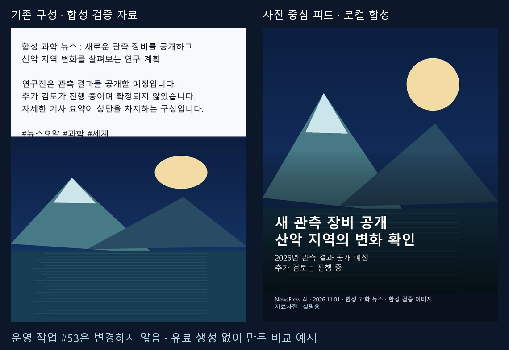

# 뉴스 기반 이미지 — 사진 중심 피드 편집 개발 결과

- 날짜: 2026-11-01
- 개발 브랜치: `codex/newsflow-photo-feed-editor-20261101`
- 기준: `cfdf4019996d752b7c67fb1d41e2b420ae0b5d16`
- 구현 커밋: `e498a3f063d92092c8e72820a544ed727daff9e0`
- 범위: `/studio/images?mode=top3` (기존 `mode=news` 연결도 유지)
- 운영 적용: **하지 않음**. 운영 앱 실행·종료·재시작·운영 데이터 읽기/쓰기·원본 #53 수정 없음.

## 먼저 확인한 기존 구성

`creation/top_three_feeds.py::prompt_for()`가 기존 카드의 상단 문구/하단 그림 구성을 생성 지시문으로 전달하고, `_accept()`가 `publishing/feed_titles.py::render_title()`로 한글 제목을 로컬 후처리한다. 기존 결과의 문구 일부는 생성 이미지 자체에 들어 있을 수 있으므로, 새 스타일과 기존 결과의 편집을 분리했다.

TOP 3 일괄/선택 1건 제작, 4:5, 견적·예산 승인, 무료 제목 교정, 확대, 다운로드, 게시용 검토본 저장을 재사용했다. 대시보드·독립 이미지·캐릭터·뉴스 수집 기능은 개편하지 않았다.

## 구현

1. **사진 중심 피드 스타일**: `photo_feed_v1`. 새 생성은 배경 그림만 요청하고 한글 문구는 로컬 합성한다. 기존 카드 스타일과 기존 작업의 비용 승인 지문은 유지한다.
2. **큰 선택 미리보기**: 왼쪽 기사·제작 범위, 가운데 결과 1/2/3 선택과 큰 4:5 이미지, 오른쪽 편집. 생성 모델·품질·비용은 접힌 영역에 있다. 편집 대상 TOP 번호와 저장 버전을 표시한다.
3. **문구·배치 편집**: 제목/핵심 설명/명시적 줄바꿈, 강조 단어·색, 텍스트 높이, 이미지 비중, 그라데이션 높이·강도, 자르기 범위, 브랜드·날짜·출처·크레딧. 길이를 넘으면 수정 안내를 표시하며 자동 축소나 잘라내기는 하지 않는다.
4. **캡션 분리**: 저장된 원제·요약·분석·대본을 그대로 두고 편집 문구를 별도 저장한다. 긴 요약과 해시태그는 캡션 편집 영역에 둔다. 설명이 부족하면 확인 필요로 표시한다. 진행 상태와 수치 변화는 검토 안내를 표시하며 자동으로 사실을 보완하지 않는다.
5. **배경 분리**: 기존 생성 원본, 기존 완성 이미지, 사용권을 확인해 로컬 보관된 기사 이미지, 사용자가 고른 로컬 이미지. 사진/자료사진/AI 구분과 크레딧을 유지한다. 기사 이미지의 소유자를 임의 추정하지 않는다.
6. **버전 보존**: `AppSetting`의 `feed-design:{batch}:{rank}`에 초안·연결·수정값을 별도 저장한다. 합성할 때 배경 PNG와 결과 JPEG를 각각 새 UUID 파일로 보관한다. 예전 배경 파일이 없어져도 저장 버전의 배경으로 편집할 수 있다. 기존 결과·원본·비용·다른 순위·자동 제작 기본값을 덮어쓰지 않는다. DB migration 없음.
7. **정확한 미리보기**: 브라우저와 저장본이 같은 로컬 렌더러를 사용한다. 한글 Windows 글꼴·줄바꿈·좌표·색상이 일치하며, 테스트에서 미리보기와 저장 JPEG의 바이트 일치를 확인했다. CSP를 완화하지 않고 인증된 앱 내부 이미지 경로를 쓴다.
8. **게시 연결**: 선택한 편집 버전을 기존 게시용 검토본 저장에 연결한다. 이미지 바이트·제목·캡션·출처·AI 표시를 연결하고 실제 계정 연결·업로드·게시를 실행하지 않는다.

## 비교와 화면

아래 자료는 합성 기사와 직접 그린 로컬 검증 이미지다. 실제 작업 #53/분석 #42의 운영 파일을 복제하거나 교체한 결과가 아니다. 특정 소재·색상 복제를 검증하는 자료가 아니라 문구/그림 구성 비교다.

- [기존 구성 예시](before.jpg)
- [로컬 합성 저장 결과](after.jpg)
- [1920×1080 편집 화면](editor-1920.png)
- [1366×768 편집 화면](editor-1366.png)
- [캡처 SHA-256](captures.json)

## 검증

Windows의 Python 3.12, 격리 SQLite/미디어, Fake 이미지 제공자, localhost Playwright Chromium을 사용했다. 실제 사용자 Chrome이나 운영 프로필에 연결하지 않았다.

| 검사 | 결과 |
|---|---|
| 새 편집 + 기존 예산·선택·제목·검토본 + 브라우저 집중 검사 | 100 PASS |
| 결과 선택 목록 위치 보정 후 브라우저 재확인 | 4 PASS (기존 검사와 중복, 합산하지 않음) |
| 합성 원문/썸네일을 연결한 최종 캡처 | 1 PASS (같은 브라우저 검사 재실행) |
| `tools/studio_v3/tests` 직접 실행 | 58 PASS |
| TypeScript 및 React build | PASS |
| 전체 `python -m pytest -q -rs` | 6,886 PASS / 19 FAIL / 49 SKIP / 0 ERROR (초기 실행 스냅샷) |

집중 검사에는 다음이 포함된다: 원제/긴 요약 보존, 한글·영문·숫자 혼합, 제목/설명/긴 출처 넘침, 잘못된 색상/자르기, 이미지 로딩 실패, 업로드 이미지 교체와 크레딧, 이전 버전·배경 불변, 재열기, TOP 1/2/3 격리, 외부 API 없는 편집, CSRF·정확한 경로 허용, stale revision 거부, 사용권 확인된 기사 이미지 연결, Fake 배경 3개와 각각의 1080×1350 결과, 게시 검토본의 이미지/캡션 일치.

브라우저 편집 검사에서 변경 요청은 `/design`만 발생했으며, 생성/분석/수집/계정/SNS 요청은 없었다. Fake 생성은 별도의 합성 통합 검사에서만 3번 실행했다. 실제 API 키 조회/복호화 또는 유료 호출은 수행하지 않았다.

## 보존과 남은 제한

- 현재 `C:\NewsFlowAI`, 실제 데이터·키·미디어·백업, 운영 포트/프로세스, main, PR #35는 변경하지 않았다. 운영 데이터 건수나 SHA를 새로 검사했다고 주장하지 않는다.
- 작업 전부터 존재한 `Analytics.tsx`, `character/topics.py`, `character_automation_routes.py`의 로컬 변경과 이전 캡처/validation 파일은 별도 보존하고 이 커밋에 넣지 않았다.
- 기사 배경은 사용권 확인 후 **로컬에 이미 보관된** 이미지에 한한다. 외부 원본의 자동 다운로드/수집은 추가하지 않았다.
- 기존 생성 그림에 글자가 이미 그려져 있으면 무료 편집으로 지울 수 없다. 원본 배경·다른 이미지·자르기를 사용해야 한다. 원본을 강제로 잘라내지 않는다.
- 짧은 피드 설명은 저장된 내용에서 작성·수정한다. 이번 작업은 AI 요약/번역/사실확인 호출을 추가하지 않았다. 진행 상태·수치 안내는 보조 검사이며 사실 검증 완료를 의미하지 않는다.
- 새 모델의 실제 생성 품질, 공급사 과금, 운영 설치본의 사용자 화면은 미검증이다. 이번 작업에서 운영 반영이나 외부 게시는 하지 않는다.
- 전체 회귀의 범위 밖 실패는 원인과 결과를 별도 기록하며, 이를 숨기거나 전체 PASS로 표시하지 않는다.

## 전체 회귀 최종 결과

실행은 58분 22초 동안 완료됐으며 **6,886 PASS / 19 FAIL / 49 SKIP / 0 ERROR**이다. 전체 검사는 최종 보정 전에 모듈/테스트를 읽었으므로 최종 커밋의 전체 PASS 증거로 사용하지 않는다.

- **이번 변경 관련 4개**: 예산/추가 견적의 접힌 영역 선택자, TOP 결과 선택자, 미리보기 응답(JPEG 직접 반환 → 인증된 JSON 이미지 URL)을 최종 코드에서 보정했다. 최종 집중 검사에서 통과했고, 전체 회귀 종료 후에도 해당 4개와 새 편집 단위 검사를 다시 실행했다(아래 결과).
- **환경/검증 자료 누락 10개**: `tzdata` 부재 7개, `NEWSFLOW_BASELINE_GUI_SOURCE` 부재 2개, `STEP13_ROOT` 부재 1개. 이 작업을 위해 운영 설정이나 전역 환경을 변경하지 않았다.
- **변경하지 않은 기능의 기대값/선택자 차이 5개**: Claude 카드 prompt_version(v2/v3), 캐릭터 스토리 재생성 버튼 활성 상태, 기존 이미지 참조 기능의 ‘미구현’ 기대, 음성 목록 오류 문구, 뉴스 RSS 버튼의 이전 이름. 관련 제품 코드를 수정하지 않았다. 카드/캐릭터 검사는 별도 재현에서도 실패했다(22개 중 20 PASS / 2 FAIL).
- SKIP에는 실제 유료 AI·RSS opt-in 검사와 일부 FFmpeg/글꼴 환경 검사가 포함된다. SKIP을 PASS로 합산하지 않는다. Python 3.14 실행은 이번 작업에서 검증하지 않았다.

전체 회귀 종료 후 최종 커밋 재검사: **22 PASS / 0 FAIL / 0 ERROR**. 대상은 새 편집 단위 검사와 위 4개 브라우저 검사다. 100 PASS 집중 검사와 중복되므로 합산하지 않는다.

실패별 이름과 분류는 [verification.json](verification.json)에 보존했다. **최종 판정: CONDITIONAL** — 요청한 사진 피드 개발과 집중 검증은 완료됐지만 저장소 전체 회귀는 통과하지 않았고 실제 운영 적용·실제 공급사 생성은 수행하지 않았다.

## 후속 검증 업데이트

남은 15개 실패 항목은 개발 검증 환경 연결과 테스트 보완 후 모두 통과했다. 전체 재실행 결과와 혼동하지 않도록 [후속 보고서](REGRESSION_FOLLOWUP.md)에 별도 기록했다. 운영 반영은 하지 않았다.
