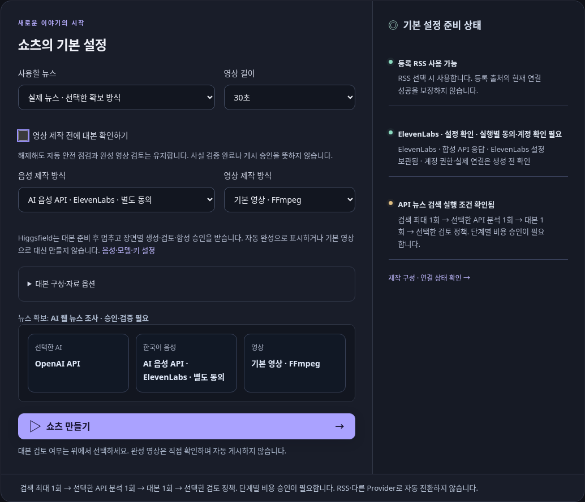

# 작업별 대본 검토·음성·영상 선택 검증

보고: 2026-10-19 11:00 KST

기준: PR #35 / `codex/newsflow-ux-video-app` / 이전 승인 `044164b29240a10c9edd965ba35c6a303cd4e6c9`.
검증 코드: `eabc21ac532dc8fe694d7ae381817b7471ce90e6`. 최종 자료 커밋은 이 코드 위의 문서·증거 전용 커밋이다.

## 동작 및 지원 범위

| 선택 | 실제 동작 |
|---|---|
| 대본 확인 체크(기본값) | 기존 뉴스 확보 → 같은 API 분석·대본 → 사용자 검토 대기 → 음성·영상 제작 |
| 체크 해제 | 새 작업에만 적용. 제작 직전 기존 구조·출처·뉴스 활용 수준·금지 표현·복제·비밀정보·분량 경고를 재검사한다. 정상 대본만 제작으로 진행하며, 경고·검증 실패·API 실패·결과 불명은 중단한다. 사실 검증 완료로 기록하지 않는다. |
| 로컬 음성 | 저장된 Windows SAPI / Supertonic 음성을 그대로 사용한다. 저장값이 무음이면 무음 검토용임을 표시한다. ElevenLabs로 전송하지 않는다. 저장된 선택이 ElevenLabs인 상태에서 로컬로 바꾸려면 설정에서 로컬 음성을 명시적으로 선택해야 하며 임의 음성을 고르지 않는다. |
| AI 음성 API | 기존 ElevenLabs Adapter를 자동 제작의 기존 FFmpeg 경로에 연결했다. 키·사용 설정·음성·모델을 확인하고, 분석 API 동의와 **별개의 실행별 대본 전송·음성 생성·크레딧 사용 동의**를 받는다. 생성 전 기존 계정 권한·플랜·잔여량 검사를 유지한다. 실패 시 다른 음성으로 대체하거나 자동 재요청하지 않는다. |
| 기본 영상 | 기존 장면·자막과 FFmpeg 경로를 사용한다. Higgsfield를 호출하지 않는다. |
| AI 영상 장면 | **완전 자동 지원 아님.** 뉴스·대본을 준비한 뒤 선택한 검토 생략 여부와 무관하게 멈춘다. 기존 `/video/ai`의 장면 계획 → 생성 승인 → 장면별 내용 검토 → 합성 승인으로 연결한다. 강제로 자동 작업을 재개해도 기본 영상 제작을 거부한다. |

Higgsfield 장면 합성은 기존 독립 승인 경로다. 자동 작업이 장면 생성부터 게시 대기함까지 자동으로 이어진다고 표시하지 않는다. **ElevenLabs + Higgsfield 동시 자동 합성도 이번 구현 범위에서 지원하지 않는다.** 해당 제한과 별도 승인을 화면에 표시하며, 이 조합은 장면 계획 생성 POST 자체를 거부한다. 로컬 음성을 선택한 AI 장면 작업은 별도 승인·합성 시에도 작업의 원래 음성을 유지한다. AI 장면 화면에서 생성·합성한 결과는 기존 내 영상 경로로 확인하며, 원래 자동 작업은 대본 준비 상태로 남는다. 실제 공급사 키·모델·사용 승인과 장면 관련성·합성 승인 없이는 생성하지 않는다.

완성 영상 검토와 SNS 공개 게시 승인은 모든 모드에서 별개다. 자동 대본 검사 통과가 사람의 사실 확인·저작권 검토·게시 승인이 되지 않는다. 불충분한 대본을 자동으로 다시 생성하거나 Provider를 바꾸지 않는다.

## 저장·계약·데이터 보존

- 기존 `AutopilotJob.stage_results.request.production_options` JSON에 버전, 검토 선택, 정확한 음성, 영상 Provider, 별도 음성 동의를 저장한다. ElevenLabs의 비밀값을 제외한 음성 ID·모델·설정도 고정한다. 전역 기본 설정 변경과 coordinator 재구성 후에도 작업 선택은 유지된다. 현재 사용 설정 해제는 기존 Provider에서 계속 차단한다.
- 새 버전 기록이 없는 과거 작업은 종전 검토·승인 정책을 유지한다. 과거 대본 검토를 생략으로 바꾸거나 기존 DB를 일괄 갱신하지 않았다.
- 대본 편집으로 이동할 때도 원래 선택을 비밀값 없는 기존 production context에 보존한다. 작업 화면은 **선택한 구성**과 실제 단계별 실행 이력을 구분한다.
- HTTP 폼에 새 옵션 필드를 추가하고, 내부 `AutopilotCoordinator.start` 및 `VideoCoordinator.start_preview`에 선택적 인수를 추가했다. 기존 호출은 종전 기본 동작이다. 새 검색 API·제작 엔진·TTS/영상 Provider·대시보드를 만들지 않았다.
- 게시·OAuth·뉴스·IntelligenceService·FFmpeg engine·ElevenLabs Adapter·Higgsfield Adapter·migration·DB 모델·의존성·`run.bat`은 변경하지 않았다. 기존 엔진을 호출하는 연결부와 UI만 보완했다.
- 실제 사용자 DB·DPAPI 키·설정·MP4와 운영 앱을 변경하거나 재시작하지 않았다. 테스트는 임시 DB·합성 키·합성 응답만 사용한다.
- 추측 금액 예약·요청별 금액 제한을 추가하지 않았다. 기존 응답 사용량 기록 및 공급사 Adapter의 안전 장부를 재사용한다. Fake 사용량은 실제 청구 증거가 아니다. 실제 공급사 사용량·청구액은 NOT VERIFIED다.

## Cloud 검증

최종 코드의 변경 범위: **282 passed / 1 skipped / 0 failed / 0 errors / 1 warning**. Windows CI와 같은 테스트 목록이며, 유일한 Skip은 기존 native Windows DPAPI 플랫폼 조건이다. 새 Skip이나 테스트 삭제는 없다. Ruff / pip check / diff check PASS. warning은 기존 Starlette/httpx TestClient deprecation이다.

새 작업 옵션 테스트 37건은 위 수치에 포함된다. 체크·해제, 잘못된 구조·숫자·출처·금지 표현, 실패·결과 불명 API, 작업 설정 복구, 다른 기본 음성·모델로의 자동 전환 차단, 별도 음성 동의, CSRF와 과거 작업 정책을 검증했다.

실제 Chromium에서 Fake OpenAI/Claude 각각 뉴스 검색 1회 → 분석 1회 → 대본 1회 → 검토 생략 선택 → 기존 ElevenLabs Adapter의 Fake 계정/음성 응답 → 기존 FFmpeg → MP4 재생 → 최종 검토 대기를 확인했다. 별도 음성 동의가 없으면 API 호출 전에 422로 거부한다. 정상 길이의 합성 대본을 주입했으며, 공유 Fake의 짧은 대본이 검사에서 중단되는 현상을 해결하려고 제품 검사를 완화하지 않았다.

MP4는 1080×1920 / H.264 / AAC / 약 30.021초다. **합성 무음 PCM**을 사용했으므로 실제 ElevenLabs 음질·한국어 발음·사람이 평가한 음성/자막 동기화·AI 콘텐츠 품질 PASS를 뜻하지 않는다. 기존 로컬 음성 Fake 제작 및 통합 게시 서비스 검증도 유지했다. Higgsfield 연동 경계는 기존 Fake Video Provider의 승인·생성·복구·FFmpeg 샘플 검증으로 확인했으며 실제 Higgsfield 호출은 없다.

1366×768, 1920×1080, 390×844에서 새 선택 필드의 잘림·가로 넘침과 폼 입력·체크박스·별도 동의·실행 동선을 확인했다. 브라우저 크기 검증은 사용자 Windows 배율 검증이 아니다.

### 기존 FAIL 기록

넓힌 영향 범위의 중간 실행은 **295 passed / 5 failed / 0 errors**였다. 실패한 5개 ID만 승인 기준 커밋의 격리 소스와 `73bb9ca` 코드에서 같은 Python 3.12 가상환경·의존성·명령으로 비교했다. ID와 실패 조건이 일치했고, 무작위 request ID와 pytest의 부가 `where` 행만 정규화했다. 모두 기존 57개 실패 목록에 포함된다. 실제 CLI 로그인이나 유료 API를 실행하지 않았다.

해당 5건은 이전 동의 안내 문구 2건, 이전 호출 인수 기대값 1건, 이전 AI readiness mock에 따른 동의/승인 안내 기대값 2건이다. 새 옵션 테스트로 바꾸어 숨기거나 삭제·skip하지 않았다. 자세한 ID와 비교 기준은 [비교 JSON](evidence/production-choices/legacy-five-comparison.json)에 보존한다.

**기존 전체 회귀 57 FAIL 기록은 유지한다.** 전체 회귀를 다시 실행하지 않았으며, 변경 범위의 통과를 전체 PASS나 전체 신규 실패 0건으로 확대하지 않는다.

추가로 기존 AI 장면 GUI 모듈은 **9 passed / 2 failed**였다. 기존 6개 메뉴 개수 기대값과 Linux에서 Windows를 모의할 때의 `shutil._winapi` 실패이며, 두 ID 모두 기존 57개 목록에 있다. 같은 환경의 기준 커밋에서도 동일한 ID와 주된 실패 메시지를 재현했다. [추가 비교 JSON](evidence/production-choices/legacy-scene-gui-comparison.json)에 보존한다. 새 장면 계획 차단·작업 음성 보존 검증은 위 변경 범위 테스트에 포함된다.

## Windows Actions

[최종 코드 실행](https://github.com/jsbae1979-prog/JSBAE/actions/runs/39187420264) — **SUCCESS**. 최종 실행 코드 SHA는 `eabc21ac532dc8fe694d7ae381817b7471ce90e6`다.

| Windows runner | 변경 범위 pytest | Ruff / pip check / Chrome / BAT |
|---|---|---|
| Python 3.12.10 | 283 passed / 0 failed / 0 errors / 0 skipped / 1 warning | PASS |
| Python 3.14.8 | 283 passed / 0 failed / 0 errors / 0 skipped / 1 warning | PASS |

기존 native DPAPI 합성 검증, 기존 API 분석·대본·음성/영상·게시 계약, 새 선택·동의·차단 동선을 실행했다. BAT는 runner의 새 임시 사용자 데이터 폴더에서 8765 loopback 기동 → 중복 실행 차단 → CTRL_BREAK 종료 로그 → 같은 SQLite marker·무결성 확인 후 재시작을 검증했다. 실제 사용자 앱이나 데이터에 접근하지 않았다.

첫 코드 `73bb9ca`의 [이전 Windows 실행](https://github.com/jsbae1979-prog/JSBAE/actions/runs/39186849055)도 양쪽 279 passed였지만, 이후 AI 장면 합성의 작업별 음성 고정·미지원 조합 차단을 보완했으므로 위 최종 실행과 구분한다. 전체 회귀 실행이나 실제 공급사 성공으로 보고하지 않는다. [최종 CI 메타데이터](evidence/production-choices/windows-actions.json), [3.12 BAT 증거](evidence/production-choices/windows-312-bat.json), [3.14 BAT 증거](evidence/production-choices/windows-314-bat.json)를 확인할 수 있다.

Windows runner 결과와 사용자 Windows 11 PC 운영은 구분한다. 사용자 PC의 기존 DB·DPAPI 키·실제 음성·화면 배율·실제 뉴스/API·실계정 연동·게시·Higgsfield 품질은 **NOT VERIFIED**다.

## 증거와 종료

- [Cloud 요약·명령·보존 경로](evidence/production-choices/cloud-summary.json)
- [OpenAI + ElevenLabs Fake 동선](evidence/production-choices/cloud-openai-options.json)
- [Claude + ElevenLabs Fake 동선](evidence/production-choices/cloud-claude-options.json)
- 실제 OpenAI / Claude / ElevenLabs / Higgsfield 유료 요청 **0건**, 실제 OAuth·SNS 업로드·게시 **0건**.
- 기존 [Draft PR #35](https://github.com/jsbae1979-prog/JSBAE/pull/35)를 유지한다. 새 PR·main 병합·다른 브랜치 병합·운영 반영은 하지 않았다. 최종 결과 제출 후 추가 개발을 중단한다.

## 후속 최종 통합 개발

기존 결과는 그대로 보존한다. 전체 AI 영상·ElevenLabs 결합·단일 피드의 후속 변경과 검증 한계는 [최종 통합 보고서](final_production_report.md)를 참고한다.
