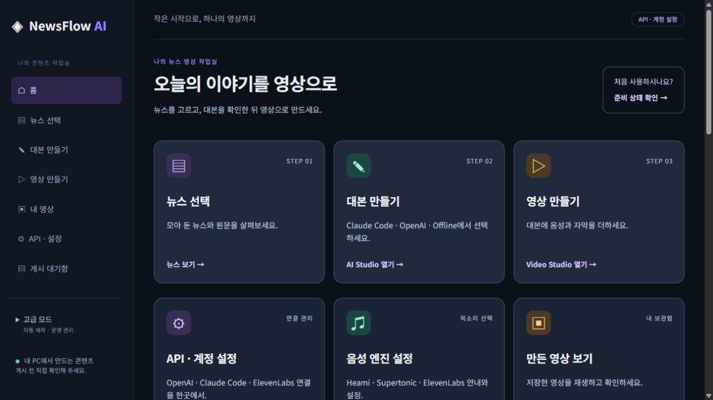
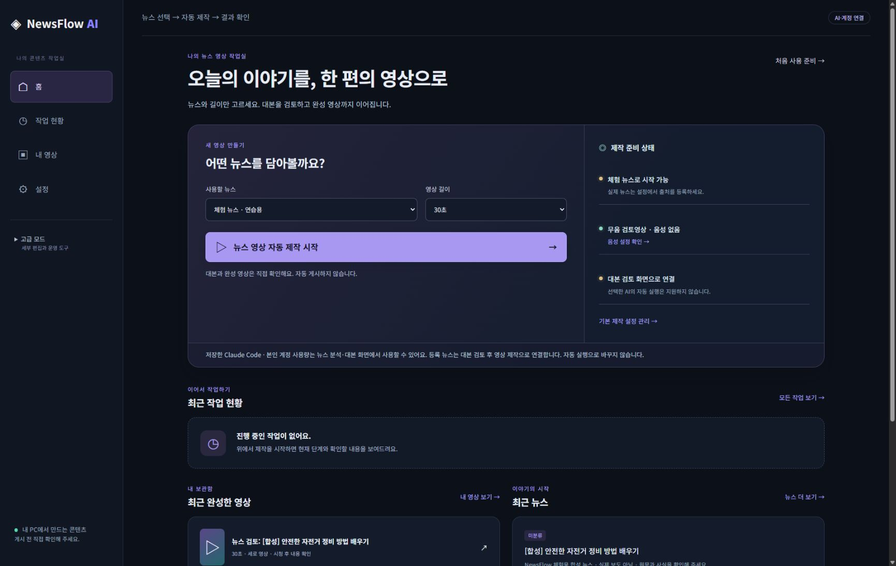
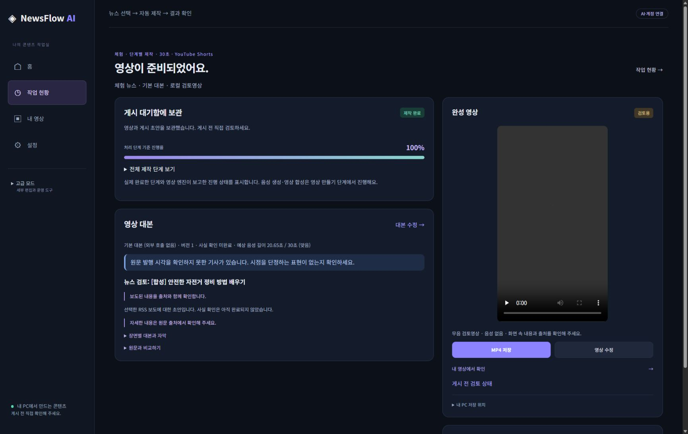
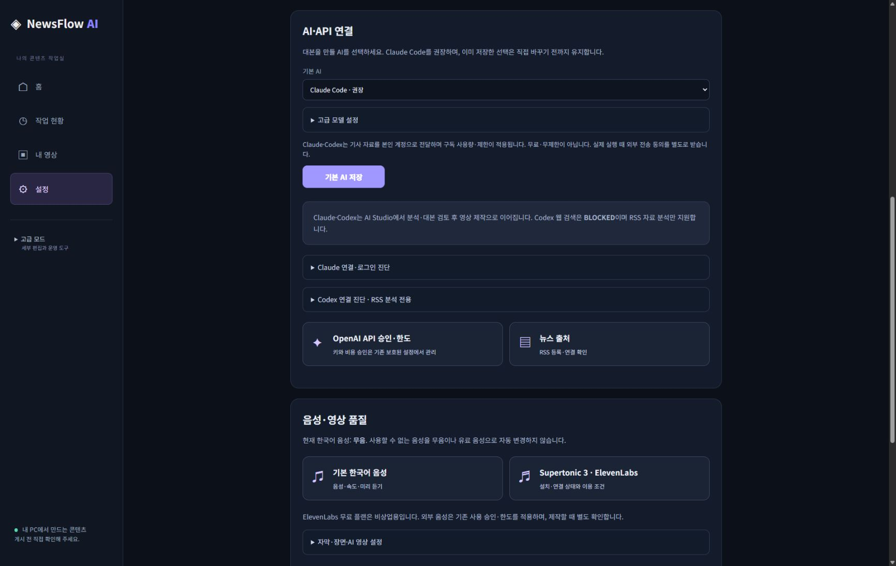

# NewsFlow AI UX/UI 단순화

기준: `feat/newsflow-codex-research-integration` / `bfcff1589db0a871309ab93145f8b55b88b4a1a1`.
작업 브랜치: `feat/newsflow-ux-simplification`. 기존 PR·main을 병합하지 않았다.

## 변경 내용

기존 홈은 일곱 메뉴와 여러 바로가기로 기능별 화면 이동을 요구했고, AI 기본값·연결 진단이 여러 화면에 나뉘어 있었다. Video Studio는 자막·장면·출력 정보를 기본 화면에 모두 노출하고 저장된 음성 대신 무음을 먼저 선택했다.

| 이전 | 이후 |
|---|---|
| 홈·뉴스·대본·영상 제작·내 영상·API 설정·게시 대기함 | 홈·작업 현황·내 영상·설정 |
| 기능별 바로가기 중심 홈 | 뉴스 종류·영상 길이 두 입력 + 자동 제작 시작 |
| AI Studio의 기본값 저장·연결 진단 | 통합 설정에서 기존 `studio_*` 값을 저장, 진단은 접힌 고급 항목 |
| 모든 영상 옵션을 기본 노출 | 대본·길이·음성·필수 검토·제작, 세부 편집은 고급 항목 |

기존 Autopilot coordinator, 뉴스 수집·중복 제거, Offline 대본, FFmpeg, SQLite, 검토 게이트, 설정 저장소와 URL을 재사용했다. 새 migration·Provider·유료 호출 경로는 추가하지 않았다. 진행률은 실제 엔진 상태를 사용한다.

홈의 체험 제작은 명시적으로 Offline을 사용한다. 등록 뉴스에서 Claude·Codex를 선택한 경우 AI Studio 검토 흐름으로 안내하며 자동 실행하지 않는다. ElevenLabs와 사용할 수 없는 음성은 설정 안내로 멈추고 대체하지 않는다. Codex 웹 검색은 BLOCKED다.

## 검증

- Windows 11 / 기존 Python 3.14 가상환경: 변경 및 관련 테스트 **81개 통과**. 새 UX 25개, 기존 Easy UI·Codex·Claude 54개, 기존 Video GUI·음성 2개. Ruff·diff check 통과. 전체 회귀는 실행하지 않았다.
- 기존 `run.bat` 정상 재시작 후 Chrome에서 홈·통합 설정 확인. 기존 Codex 선택·Microsoft Heami 설정 유지.
- 별도 테스트 데이터(8776 포트)에서 체험 뉴스 선택 → 대본 검토(50%) → 실제 FFmpeg MP4 → 최종 검토(83%) → 로컬 대기함·내 영상(100%) 확인.
- 시험 MP4: 1080×1920 H.264/AAC, **30.021354초**, 명시적 무음 모드. Chrome 재생 시간이 0 → 14.17초로 증가했고 오류가 없었다. 한국어 음성 품질을 새로 검증한 결과는 아니다.
- 테스트 설정에서 Claude 선택·저장 확인. 설정 저장만으로 추론이 시작되지 않았고 외부 AI 사용 기록은 0건. 기본값 재로딩·재생성 검증은 핵심 테스트에 포함된다.
- 모바일 폭 점검: 기본 메뉴·제작 입력 유지, 가로 넘침 없음.
- 테스트 서버와 운영 서버를 동일 호스트의 다른 포트로 번갈아 열어 CSRF 쿠키 충돌이 한 번 발생했다. 새로고침 후 정상 진행했으며 보안 검사를 변경하지 않았다. 운영은 기존 단일 포트를 유지한다.
- 게시 초안은 `blocked`, 대본은 `review_required`, 사실·저작권·출처 승인 값은 모두 false. 실제 API·OAuth·SNS·자동 시작 등록 0건.

## 화면

이전 홈은 내장 브라우저, 이후 화면은 Windows Chrome 캡처다. 이후 캡처는 합성 뉴스 전용 테스트 데이터다.

## 보존 및 남은 사항

사용자 SQLite는 작업 전 읽기 전용 연결로 백업했다. 백업·DB·영상·세션·키는 Git에 포함하지 않았다. 사용자 뉴스 9개·대본 3개·영상 2개와 기존 최종 검토 대기 작업을 유지했다. 실제 사용자 설정 변경은 하지 않았다.

Claude·Codex의 등록 뉴스 대본 제작은 기존 AI Studio에서 진행하며, 홈에서 선택한 45·60초는 대본 화면에서 다시 선택해야 한다. Supertonic·ElevenLabs는 기존 제작별 선택 구조를 유지한다. 실제 유료 호출·음성 청취·SNS 게시·모든 고급 기능의 전체 회귀는 이번 검증 대상이 아니다.

변경 파일: GUI 라우트 3개, 템플릿 11개, CSS 1개, 연결 JS 2개, 테스트 6개, 전용 Windows workflow, 본 보고서와 화면 캡처. 엔진·DB 모델·migration·고정 의존성은 변경하지 않았다.

최종 코드 SHA·Draft PR·Windows Actions 결과는 업로드 후 아래에 기록한다.
